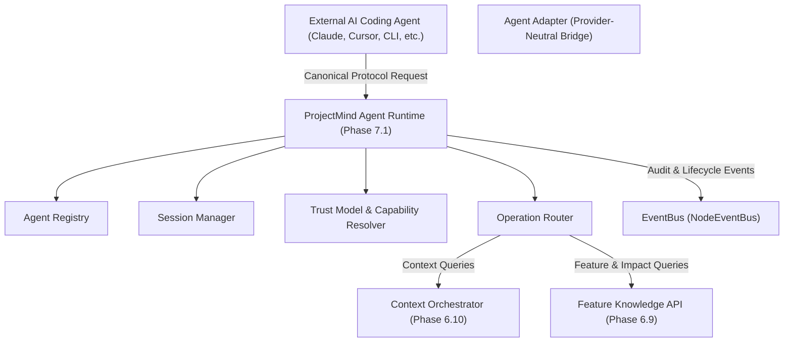

# Agent Integration Architecture (Phase 7.1)

## 1. Overview & System Purpose

The **Agent Integration Architecture** serves as the foundational, provider-neutral boundary connecting ProjectMind to external AI coding agents (such as Claude Code, Cursor, Codex, Gemini CLI, and custom agents).

ProjectMind acts as an AI-native repository memory and feature intelligence engine. It does not replace the external agent's reasoning or tools; instead, it supercharges external agents with deterministic context packages, feature intelligence, dependency awareness, impact analysis, and verification channels.

---

## 2. Architectural Boundaries & Guarantees

### What ProjectMind Provides to Agents:
- **Repository Intelligence Access**: Deep structural, semantic, and relational understanding of codebase components.
- **Feature Knowledge Retrieval**: Complete profiles, dependencies, behaviors, health metrics, and evolution histories.
- **Optimized Context Orchestration**: Deterministic, budget-governed, model-adapted context packages.
- **Change Impact & Architecture Querying**: Upstream/downstream impact propagation, risk scoring, and architectural pattern mapping.
- **Execution & Verification Ingestion**: Structured channels for agents to report file changes and test verification results.
- **Curated Knowledge Updates**: Secure mechanisms for ingesting high-confidence learned facts into project memory.

### Strict Non-Goals (What ProjectMind Prohibits):
- **Autonomous Code Execution**: ProjectMind does not execute arbitrary code on behalf of agents.
- **Shell / Process Spawning**: Shell commands, terminal sessions, and child process execution are strictly blocked.
- **Uncontrolled Direct File Modifications**: File modifications belong to agents or dedicated mutation services, never raw execution payloads in integration requests.
- **Identity Provider Implementation**: Agent authentication is decoupled from core capability resolution.

---

## 3. Subsystem Delegation

Operation handlers in the Agent Integration layer do not duplicate repository parsing, AST inspection, or context planning. They strictly delegate to canonical subsystems:

| Operation | Delegated Subsystem | Method Invocation |
|:---|:---|:---|
| `GET_CONTEXT` | `IContextOrchestrator` (Phase 6.10) | `orchestrateContext(request)` |
| `GET_FEATURE` | `IFeatureKnowledgeAPI` (Phase 6.9) | `getFeatureProfile(featureId, options)` |
| `GET_FEATURE_CONTEXT` | `IContextOrchestrator` (Phase 6.10) | `getFeatureContextForTask(request)` |
| `GET_IMPACT` | `IFeatureKnowledgeAPI` (Phase 6.9) | `getFeatureImpact(featureId, options)` |
| `GET_ARCHITECTURE` | `IFeatureKnowledgeAPI` (Phase 6.9) | `getFeatureArchitecture(featureId, options)` |
| `GET_HISTORY` | `IFeatureKnowledgeAPI` (Phase 6.9) | `getFeatureHistory(featureId, options)` |
| `GET_HEALTH` | `IFeatureKnowledgeAPI` (Phase 6.9) | `getFeatureHealth(featureId, options)` |
| `EXPLAIN_CONTEXT` | `IContextOrchestrator` (Phase 6.10) | `getContextExplanation(request)` |
| `REFRESH_CONTEXT` | `IContextOrchestrator` (Phase 6.10) | `orchestrateContext({ freshnessPolicy: 'CURRENT' })` |
| `REPORT_EXECUTION` | `IEventBus` / Audit Log | Emits `agent.execution.reported` |
| `REPORT_VERIFICATION` | `IEventBus` / Audit Log | Emits `agent.verification.reported` |
| `UPDATE_KNOWLEDGE` | `IEventBus` / Knowledge Ingestion | Emits `agent.knowledge.updated` |
