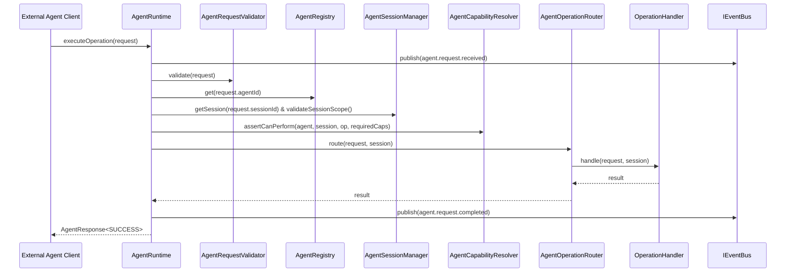

# Agent Integration Runtime (Phase 7.1)

## 1. Runtime Overview

The `AgentRuntime` is the central engine orchestrating all external agent communications, sessions, security assertions, handler dispatching, and event logging in ProjectMind.



---

## 2. Core Runtime Subsystems

### `AgentRegistry` (`IAgentRegistry`)
- Manages agent registrations, statuses (`ACTIVE`, `INACTIVE`, `SUSPENDED`, `DEREGISTERED`), capabilities, and trust levels.
- Prevents duplicate registrations of active agents (`AgentConflictError`).
- Emits lifecycle events: `agent.registered`, `agent.deregistered`, `agent.status.changed`, `agent.capability.changed`.

### `AgentSessionManager` (`IAgentSessionManager`)
- Manages stateful contextual sessions tied to an agent, `workspaceId`, and `repositoryId`.
- Strictly enforces scope boundaries: requests executing within a session must have matching workspace/repository IDs.
- Tracks `lastActivityAt` and supports session TTL expiration (default 1 hour).
- Emits `agent.session.created` and `agent.session.closed`.

### `AgentCapabilityResolver` (`IAgentCapabilityResolver`)
- Evaluates effective capabilities across agent registration and optional session restrictions.
- Enforces trust level constraints (`AgentTrustModel`).
- Asserts that both agent and active session possess all required capabilities before execution.

### `AgentRequestValidator`
- Validates envelope completeness (`requestId`, `protocolVersion`, `operation`, `agentId`, `workspaceContext`).
- Checks safety boundary: inspects payload to reject execution injections (`exec`, `eval`, `shellCommand`, etc.).

### `AgentOperationRouter` (`IAgentOperationRouter`)
- Decouples operation dispatch from the runtime.
- Routes valid requests to registered handlers.

---

## 3. Dependency Injection & Standalone Instantiation

The runtime supports both enterprise DI container registration and lightweight programmatic setup:

```typescript
// DI Container Registration
import { AgentDISetup } from 'src/agent/di/AgentDISetup.js';
AgentDISetup.register(container, {
  contextOrchestrator,
  featureKnowledgeApi,
  eventBus,
});

// Programmatic Instantiation (No DI container needed)
const runtime = AgentDISetup.createRuntime({
  contextOrchestrator,
  featureKnowledgeApi,
  eventBus,
});
```
