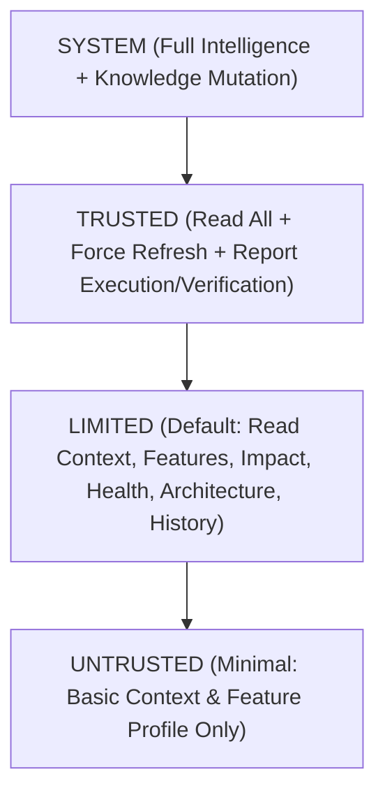

# Agent Integration Security & Trust Architecture (Phase 7.1)

## 1. Security Philosophy

ProjectMind adheres to strict security principles when interacting with external AI agents:
1. **Never Trust Input Without Verification**: Envelopes, schemas, scopes, and capabilities are checked on every call.
2. **Boundary Enforcement**: ProjectMind is an intelligence and context provider, never an arbitrary code execution sandbox.
3. **Workspace Isolation**: Agents cannot hop workspaces or access repositories outside their granted scope.
4. **Least Privilege**: Capabilities and trust levels restrict what each agent can read, refresh, or report.

---

## 2. Trust Model (`AgentTrustModel`)

Agents are categorized into one of 4 hierarchical trust levels:

### Trust Level Definitions:

| Trust Level | Permitted Operations | Typical Use Case |
|:---|:---|:---|
| `UNTRUSTED` | `GET_CONTEXT`, `GET_FEATURE`, `EXPLAIN_CONTEXT` | Public sandboxes, third-party unverified extensions |
| `LIMITED` | All Read Ops (`GET_CONTEXT`, `GET_FEATURE`, `GET_FEATURE_CONTEXT`, `GET_IMPACT`, `GET_ARCHITECTURE`, `GET_HISTORY`, `GET_HEALTH`, `EXPLAIN_CONTEXT`) | Default standard AI coding agents (Claude Code, Cursor) |
| `TRUSTED` | All Read Ops + `REFRESH_CONTEXT`, `REPORT_EXECUTION`, `REPORT_VERIFICATION` | Verified IDE extensions, CI/CD automated test runners |
| `SYSTEM` | All Operations including `UPDATE_KNOWLEDGE` | Internal ProjectMind background services & orchestrators |

---

## 3. Boundary Defenses

The `AgentBoundary` class defends against boundary escape attempts:
- Payload inspection: Property keys such as `exec`, `execSync`, `spawn`, `shellCommand`, `terminalCommand`, `eval`, or `bypassSecurity` immediately trigger `AgentOperationError`.
- Scope assertion: Missing, empty, or whitespace-only `workspaceId` or `repositoryId` immediately trigger `AgentScopeError`.
- Session scope enforcement: If a request specifies a `sessionId`, the runtime guarantees that the request's `workspaceId` and `repositoryId` strictly match the session's bound IDs.
