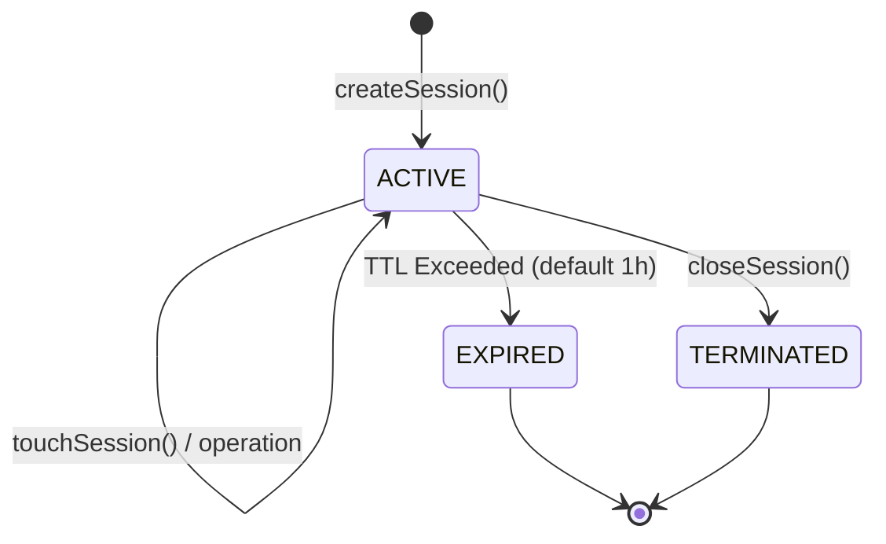

# Agent Integration Sessions & Scope Bounding (Phase 7.1)

## 1. Session Lifecycle

An `AgentSession` represents an active working window for an external agent within a specific workspace and repository.

### Session States:
- **`ACTIVE`**: The session is valid and can process operations.
- **`IDLE`**: Session is temporarily inactive.
- **`EXPIRED`**: Session idle duration exceeded configured `sessionTtlMs` (default: 3,600,000 ms / 1 hour). Further operations are rejected with `AgentOperationError`.
- **`TERMINATED`**: Session was explicitly closed via `closeSession()`. Further operations are rejected with `AgentOperationError`.

---

## 2. Session Capability Narrowing

When creating a session, an agent may optionally pass `requestedCapabilities`:
- If omitted, the session inherits the agent's full set of registered capabilities.
- If provided, the requested capabilities must be a subset of the agent's registered capabilities.
- If any requested capability exceeds what the agent possesses, session creation fails with `AgentCapabilityError`.

This enables agents to establish least-privilege sessions for sensitive or limited subtasks.

---

## 3. Scope Bounding & Isolation

Every session is immutably bound at creation time to:
- `agentId`: The registering agent's identifier.
- `workspaceId`: The target workspace.
- `repositoryId`: The target repository.

When executing an operation with a `sessionId`, the runtime verifies:
1. The session exists and is `ACTIVE`.
2. The session was created by the calling `agentId` (`AgentScopeError` on mismatch).
3. The request's `workspaceContext.workspaceId` matches `session.workspaceId` (`AgentScopeError` on mismatch).
4. The request's `workspaceContext.repositoryId` matches `session.repositoryId` (`AgentScopeError` on mismatch).

This guarantees strong multi-tenant and multi-workspace isolation.
