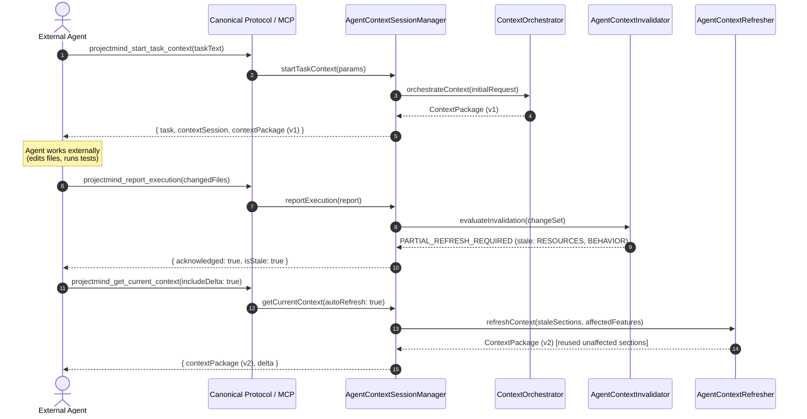

# Agent Context Architecture

## 1. Executive Summary

Phase 7.4 of ProjectMind implements **Agent Context Integration**, bringing the Context Orchestrator directly into the agent session lifecycle. The core principle governing this subsystem is:

> **"Context follows the task."**
> External coding agents do not repeatedly rescan or explore the codebase. ProjectMind maintains a stateful, versioned, and freshened context relationship throughout the task lifecycle.

## 2. Fundamental Architectural Division of Responsibilities

ProjectMind maintains a strict boundary between repository intelligence and external coding agents:

| Subsystem | Responsibility | What it DOES NOT do |
| :--- | :--- | :--- |
| **ProjectMind** | • Understand repository state • Map and resolve features • Select relevant knowledge • Construct token-budgeted context packages • Track context freshness & staleness • Analyze impact of reported changes • Compute context deltas • Perform smart partial refreshes | • Edit workspace files • Execute arbitrary shell commands • Run test suites directly • Synthesize production code • Act as an autonomous coding agent |
| **External Agent** (Claude, Cursor, CLI) | • Prompt reasoning & planning • Code modification & authoring • File editing & formatting • Test execution & verification • Reporting changes back to ProjectMind | • Compute global repository topology • Rescan codebase repeatedly • Calculate feature dependencies manually |

## 3. Core Components

1. **`AgentContextSessionManager`**: Coordinates session lifecycle, task transitions, optimistic concurrency version checks, and event emissions.
2. **`AgentContextInvalidator`**: Analyzes reported file changes against `IFeatureKnowledgeAPI.getFeatureImpact()` to identify affected features and mark only relevant sections as stale (`NO_REFRESH_REQUIRED`, `PARTIAL_REFRESH_REQUIRED`, `FULL_REFRESH_REQUIRED`).
3. **`AgentContextRefresher`**: Executes smart partial refreshes by reusing unaffected context sections (architecture, untouched features) and fetching only stale sections.
4. **`AgentContextDeltaCalculator`**: Computes fine-grained diffs between ContextPackage versions (added, removed, modified, and unchanged items) with safety checks.
5. **`AgentContextPinManager`**: Allows agents to pin features, resources, and sections to ensure retention across budget constraints.
