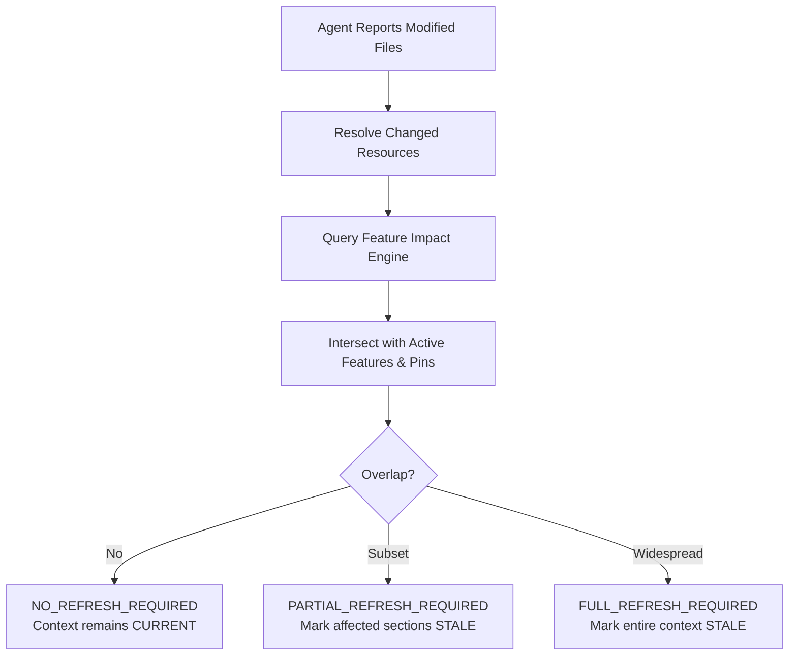

# Context Invalidation & Smart Refresh

## 1. Overview

Context staleness occurs naturally as an external agent makes modifications to code files. Rather than naively rescanning the entire repository or rebuilding the entire context package, ProjectMind utilizes **impact-driven invalidation** and **smart partial refresh**.

## 2. Invalidation Flow

When an agent reports changes via `projectmind_report_execution`:

## 3. Invalidation Decisions

- `NO_REFRESH_REQUIRED`: Changes touched documentation, unrelated modules, or files outside the active feature boundary.
- `PARTIAL_REFRESH_REQUIRED`: Changes touched specific active files or features. Only relevant sections (e.g. `RESOURCES`, `BEHAVIOR`, `TESTS`) are invalidated.
- `FULL_REFRESH_REQUIRED`: Widespread architectural or dependency changes across all active features.
- `REFRESH_DEFERRED`: Changes acknowledged but refresh deferred until explicitly requested.

## 4. Smart Partial Refresh Algorithm

When `refreshContextSession` or `getCurrentContext` (with `autoRefreshIfStale: true`) is invoked:

1. **Inspect Stale Sections**: Identify which sections are dirty (e.g., `RESOURCES`, `TESTS`).
2. **Reuse Unaffected Knowledge**: Keep untouched architecture diagrams, history logs, and unaffected feature profiles.
3. **Targeted Retrieval**: Invoke `IContextOrchestrator` with a scoped `ContextRequest` targeting only affected features and dirty sections.
4. **Merge & Re-budget**: Merge newly retrieved elements into the existing package, re-calculate token budgets, and assign a new package ID.
5. **Increment Context Version**: Advance version from $V_n$ to $V_{n+1}$.
6. **Emit Event**: Publish `agent.context.refreshed` on `IEventBus`.
