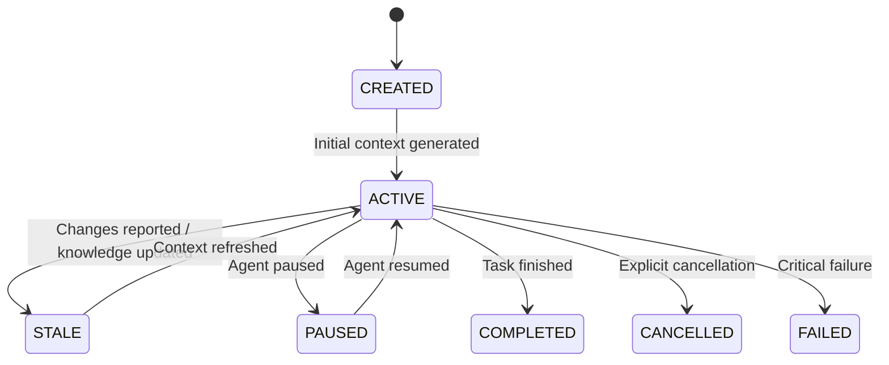

# Context Session & State Management

## 1. Overview

An `AgentContextSession` embodies the stateful, persistent relationship between:
- An AI Agent & its AgentSession
- An active Task
- Authorized Repository scope
- Versioned Context state

## 2. Session Schema

```typescript
export interface AgentContextSession {
  readonly contextSessionId: string;
  readonly agentSessionId: string;
  readonly workspaceId: string;
  readonly repositoryId: string;
  readonly taskId: string;
  readonly taskText: string;
  readonly taskIntent: string;
  readonly status: AgentContextSessionStatus;
  readonly currentContextVersion: number;
  readonly currentKnowledgeVersion: string;
  readonly currentContextPackageId: string;
  readonly createdAt: Date;
  readonly updatedAt: Date;
  readonly lastContextRefreshAt: Date;
  readonly lastReportedChangeAt?: Date | undefined;
  readonly metadata: Record<string, unknown>;
}
```

## 3. Session Statuses



## 4. Context State Model

To prevent excessive memory consumption, ProjectMind does not store redundant full copies of large context packages. Instead, `AgentContextState` tracks references, metadata, and section freshness:

- `selectedFeatures`: Active feature identifiers
- `selectedResources`: Active file paths and resource IDs
- `includedSections`: Sections currently included in the package
- `omittedSections`: Sections pruned during budgeting
- `currentContextPackageId`: Pointer to active ContextPackage
- `contextVersion`: Monotonically increasing version number (1, 2, 3...)
- `knowledgeVersion`: ProjectMind repository knowledge snapshot version
- `freshness`: `CURRENT` | `PARTIALLY_STALE` | `STALE` | `UNKNOWN`
- `staleSections`: Specific sections identified for re-computation
- `lastChangeSet`: Summary of last external edits reported
