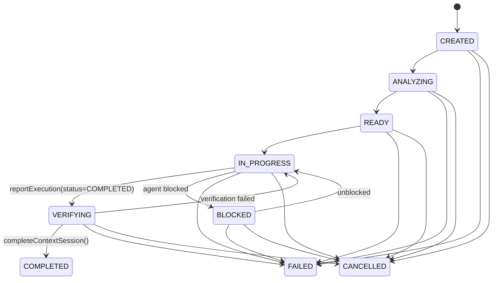

# Task Context Management

## 1. Overview

An external agent works on discrete, identifiable software engineering tasks (e.g. bugfixes, refactorings, feature implementations). ProjectMind models this via `AgentTask`.

> **Important**: `AgentTask` does NOT represent code execution by ProjectMind. It tracks the context relationship of the task being executed externally by the AI coding agent.

## 2. AgentTask Data Structure

```typescript
export interface AgentTask {
  readonly taskId: string;
  readonly contextSessionId: string;
  readonly agentSessionId: string;
  readonly workspaceId: string;
  readonly repositoryId: string;
  readonly title: string;
  readonly description: string;
  readonly intent: string;
  readonly status: AgentTaskStatus;
  readonly createdAt: Date;
  readonly updatedAt: Date;
  readonly completedAt?: Date | undefined;
  readonly metadata: Record<string, unknown>;
}
```

## 3. Task Lifecycle State Machine



## 4. Canonical Tool Operations

### `projectmind_start_task_context`
Starts a task context session.
- **Input**: `taskText`, `taskTitle?`, `taskIntent?`, `featureIds?`, `resourceIds?`, `tokenBudget?`, `compactMode?`
- **Output**: `{ task, contextSession, contextPackage, warnings, freshness, versionMetadata }`

### `projectmind_update_task_context`
Dynamically adjusts task intent or expands scope (e.g. from single-file fix to multi-component refactor).
- **Input**: `contextSessionId`, `newTaskText?`, `newIntent?`, `newTitle?`, `featureIds?`, `tokenBudget?`
- **Output**: `{ contextSessionId, taskId, updatedContextVersion, freshness, packageId, delta }`
