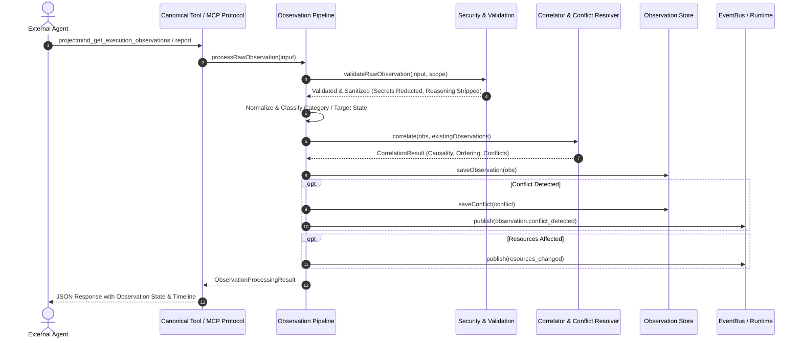

# Execution Observation Architecture

## 1. Executive Summary

Phase 7.6 of ProjectMind implements **Execution Observation**, enabling external autonomous coding agents (Claude, Cursor, Copilot, CLI agents) to record real-world execution events, command outputs, build outcomes, test results, file modifications, and blockers into ProjectMind's intelligence substrate.

The core principle governing Phase 7.6 is:

> **"Observation is Evidence, Not Execution."**
> ProjectMind is the repository intelligence backbone. It **never** executes shell commands, runs test suites, watches OS filesystems, or alters repository source code autonomously. External coding agents report execution and verification observations to ProjectMind.

---

## 2. Separation of Concerns & Architectural Boundaries

ProjectMind strictly enforces clear boundaries between repository intelligence and external agents:

| Subsystem | What it DOES | What it NEVER DOES |
| :--- | :--- | :--- |
| **ProjectMind Intelligence** | • Normalizes & validates external observations • Classifies observation categories & resource impacts • Correlates causal chains & reconstructs timelines • Detects & resolves contradictions via precedence ranking • Emits impact events (`resources_changed`) • Exposes observation query APIs & summaries | • Execute shell or subprocess commands • Run tests or linters directly • Watch the filesystem with OS file watchers • Edit code or mutate files autonomously • Automatically upgrade untrusted agent claims to system facts |
| **External Coding Agent** | • Executes builds, linters, and tests in its environment • Modifies source code and persists files • Encounters and diagnoses runtime blockers • Reports execution milestones and verification results | • Infiltrate or forge authoritative system verification • Leak internal chain-of-thought tokens or scratchpads • Execute operations across unauthorized workspace/repository boundaries |

---

## 3. High-Level Pipeline Sequence

---

## 4. Key Subsystems in Phase 7.6

1. **Canonical Models (`src/agent/observation/models/`)**:
   - `ExecutionObservation`: Comprehensive observation record with IDs, categories, timestamps, sequences, and payloads.
   - `ObservationType`: Canonical lifecycle and execution states (`TASK_STARTED`, `FILE_MODIFIED`, `COMMAND_EXECUTION`, `BUILD_RESULT`, `TEST_RESULT`, `VERIFICATION_PASSED`, etc.).
   - `ObservationProvenance`: Explicit trust attribution (`AGENT_REPORTED`, `SYSTEM_OBSERVED`, `SYSTEM_VERIFIED`).
   - `ObservationConflict`: Structured conflict records capturing contradictory claims and resolution rationale.
   - `ObservationTimeline`: Chronologically reconstructed causal timeline of task execution.

2. **Core Pipeline (`src/agent/observation/processors/`)**:
   - Ingestion, deduplication by `operationId` and structural signatures, normalization, classification, causal correlation, and storage.

3. **Security & Validation (`src/agent/observation/security/`)**:
   - Payload bounded limit (64 KB maximum).
   - Path traversal prevention (`..`, Windows and POSIX path sanitization).
   - "No Hidden Reasoning" enforcement: Prohibits model telemetry, chain-of-thought, and scratchpads.
   - Secret redaction: Automatic masking of NPM, GitHub, Slack, and generic API tokens.

4. **Query & Tool Protocol (`src/agent/protocol/handlers/observation/`)**:
   - 4 canonical tools expanding the registry to 31 tools:
     - `projectmind_get_execution_observations`
     - `projectmind_get_task_timeline`
     - `projectmind_get_execution_summary`
     - `projectmind_get_observation_conflicts`
