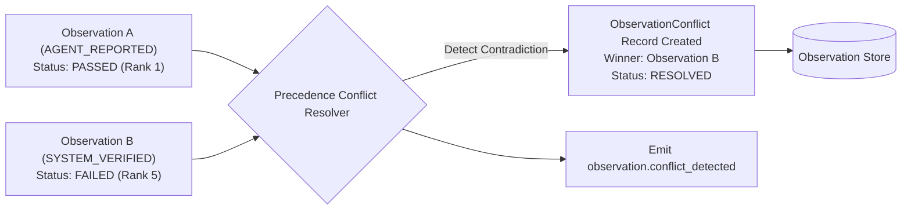

# Observation Conflicts & Precedence Resolution

## 1. Overview

In multi-agent and agent-assisted workflows, external agents may report contradictory claims (e.g. an agent reports that a unit test suite passed, while an independent system runner reports that 2 assertions failed).

`ObservationConflictResolver` detects, records, and resolves these contradictions without data loss.

---

## 2. Conflict Detection Logic

When an observation arrives, `ObservationConflictResolver` analyzes existing observations for the same task and target scope:

1. **Outcome Contradictions**:
   Comparing normalized verification outcomes:
   - `newObs.passed === false` vs `existingObs.passed === true`
   - `newObs.status === 'FAILED'` vs `existingObs.status === 'PASSED'`
2. **Resource Overwrites**:
   Detecting contradictory changes to the same files or symbols without explicit parent causality.



---

## 3. Resolution Strategies

1. **`RESOLVED_BY_TRUSTED_SOURCE`**:
   Higher precedence source wins (`SOURCE_PRECEDENCE_RANK`).
   For example, `VERIFICATION` (Rank 5) overrides `AGENT` (Rank 1).
2. **`RESOLVED_BY_NEWER_OBSERVATION`**:
   If both observations originate from the same source tier (e.g. two agent reports), the chronologically newer observation supersedes the older one.
3. **`UNRESOLVED`**:
   Contradictions between distinct peers of equal rank that cannot be resolved deterministically are marked `UNRESOLVED` with severity `HIGH`, triggering diagnostic flags for human or supervisory review.

---

## 4. Conflict Record Schema

```typescript
export interface ObservationConflict {
  readonly conflictId: string;
  readonly observationIds: readonly string[];
  readonly taskId: string;
  readonly field: string;
  readonly values: readonly ConflictingValueEntry[];
  readonly sources: readonly ObservationSource[];
  readonly severity: 'LOW' | 'MEDIUM' | 'HIGH' | 'CRITICAL';
  readonly resolutionStatus: ConflictResolutionStatus;
  readonly resolvedValue?: unknown | undefined;
  readonly resolutionReason?: string | undefined;
  readonly resolvedAt?: string | undefined;

  // Extended query helpers
  readonly existingObservationId?: string | undefined;
  readonly conflictingObservationId?: string | undefined;
  readonly winnerObservationId?: string | undefined;
}
```
