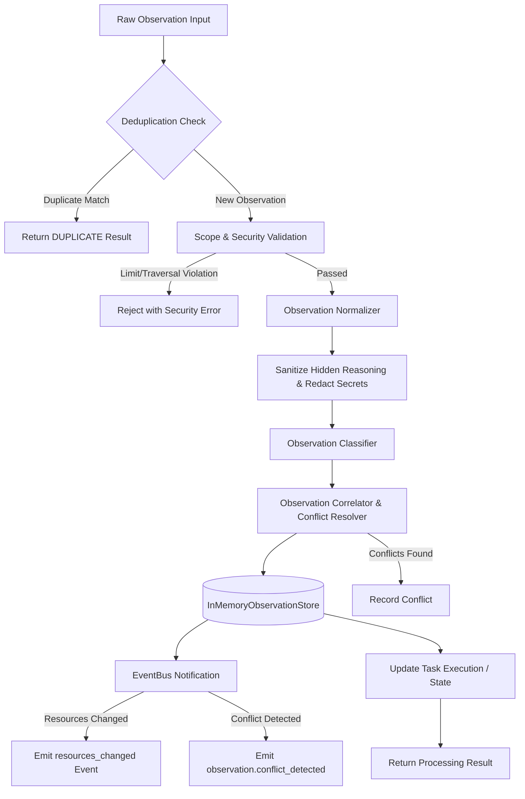

# Observation Pipeline Architecture

## 1. Overview

The `ObservationProcessor` coordinates the multi-stage ingestion, validation, normalization, classification, causal correlation, deduplication, and persistence of all execution observations.

---

## 2. Pipeline Stages

---

## 3. Stage Detailed Operations

### 3.1. Deduplication
- Checks master operation identifiers (`operationId`).
- Falls back to structural identity signature composed of:
  `taskId + type + sequenceNumber + summary + timestamp + JSON(payload)`.
- If an exact duplicate arrives, the pipeline marks `isDuplicate: true`, tags the ordering status as `'DUPLICATE'`, and avoids duplicating storage records or timeline entries.

### 3.2. Validation & Security
- Verifies non-empty IDs (`workspaceId`, `repositoryId`).
- Confirms valid `source` and canonical `type`.
- Enforces payload size limit of 64 KB (`ObservationPayloadLimitError`).
- Rejects path traversal (`..`, Windows and POSIX path separators) in `affectedResources` or file payloads.
- Rejects any presence of hidden reasoning fields (`chainOfThought`, `internalTokens`, `scratchpad`).

### 3.3. Normalization
- Generates canonical observation IDs (`obs_<timestamp>_<random>`).
- Normalizes ISO-8601 timestamps.
- Redacts secrets (NPM, GitHub, Slack, Anthropic, generic API keys).
- Strips non-standard telemetry.

### 3.4. Classification
- Determines canonical category: `TASK`, `FILE`, `SYMBOL`, `ARCHITECTURE`, `COMMAND`, `BUILD`, `TEST`, `LINT`, `TYPECHECK`, `DIAGNOSTICS`, `CONTEXT`, `VERIFICATION`, `AGENT`.
- Extracts all affected resource filepaths deduplicated across payloads.
- Computes target task state transitions:
  - `BLOCKER_ENCOUNTERED` / `TASK_BLOCKED` → `BLOCKED`
  - `TASK_STARTED` → `IN_PROGRESS`
  - `VERIFICATION_PASSED` → `VERIFIED`
  - `TASK_COMPLETED` → `COMPLETED`
  - `TASK_FAILED` → `FAILED`

### 3.5. Correlation & Conflict Resolution
- Links causal chains via `parentObservationId`, `operationId`, and `taskId`.
- Determines sequence ordering (`ORDERED` vs `OUT_OF_ORDER` vs `LATE`).
- Detects contradictions with existing observations via `ObservationConflictResolver`.

### 3.6. Event Emission & Downstream Notification
- Emits `agent.observation.received`, `agent.observation.processed`.
- When affected resources are modified, publishes `resources_changed` on `IEventBus`.
- Downstream feature intelligence subscribes to `resources_changed` to recalculate feature impact without duplicating intelligence engines.
