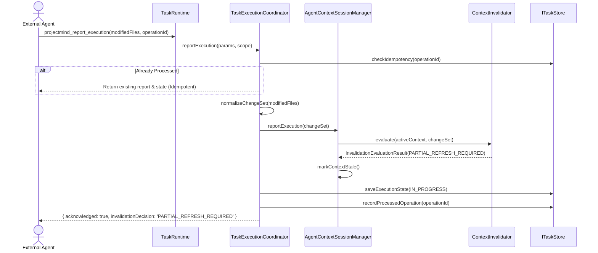

# Task Execution Reporting & Context Invalidation (Phase 7.5)

## 1. Overview

External agents report file modifications, resource additions, removals, and renames to ProjectMind via `projectmind_report_execution`. ProjectMind acts as the repository intelligence coordinator:
1. Normalizes change sets into canonical `AgentChangeSet` structures.
2. Deduplicates reports using client-supplied `operationId` idempotency keys.
3. Triggers context staleness evaluation in `AgentContextSessionManager`.
4. Returns an `invalidationDecision` (`STALE`, `FRESH`, `PARTIAL_REFRESH_REQUIRED`, or `FULL_REFRESH_REQUIRED`) to inform the agent if context re-fetching is necessary.

---

## 2. Invalidation Flow

---

## 3. Idempotency Contract

External agent network hiccups or retries could cause duplicate execution reports.
- Agents provide an optional `operationId` (UUID or unique string).
- ProjectMind tracks processed operations in `ITaskStore.recordProcessedOperation`.
- If an `operationId` is seen again, `TaskExecutionCoordinator` returns the previously acknowledged report immediately without re-processing changes or triggering redundant invalidation evaluations.
