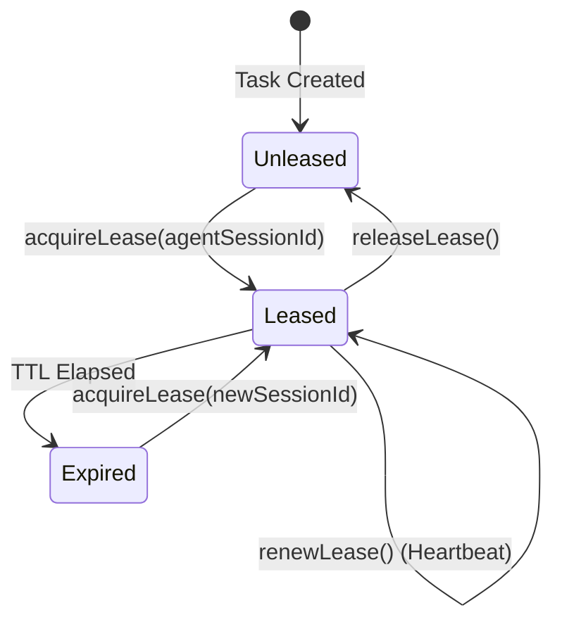

# Task Concurrency & Lease Architecture (Phase 7.5)

## 1. Optimistic Concurrency Control

To prevent dirty writes and race conditions between concurrent agents or background services:
- Every `AgentTask` includes a `taskVersion` integer field initialized to `1`.
- Any modifying operation (`updateTask`, `transition`, `start`, `complete`, etc.) increments `taskVersion`.
- Callers may provide `expectedVersion`.
- If `expectedVersion !== currentVersion`, the operation is aborted and throws `TaskVersionConflictError`.

```typescript
if (params.expectedVersion !== undefined && params.expectedVersion !== currentVersion) {
  throw new TaskVersionConflictError(params.taskId, params.expectedVersion, currentVersion);
}
```

---

## 2. Distributed Task Leases

Tasks employ non-blocking, renewable leases:
- **`acquireLease(taskId, agentSessionId, durationMs = 300000)`**: Grants temporary exclusive execution rights to an agent session.
- **`renewLease(taskId, agentSessionId, durationMs)`**: Heartbeat renewal for long-running agent tasks.
- **`releaseLease(taskId, agentSessionId)`**: Explicit release upon task completion, failure, or cancellation.
- **`assertLeaseOrOwnership(task, agentSessionId)`**: Guards modifying operations against unauthorized agent sessions while an active lease is held.


