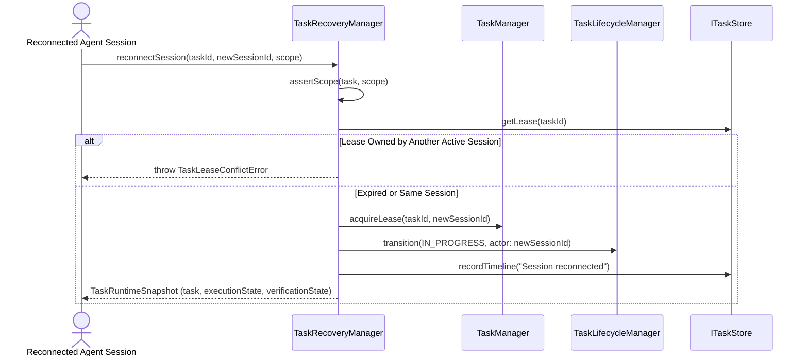

# Task Recovery & Session Reconnect (Phase 7.5)

## 1. Overview

External agents may disconnect, experience client crashes, or exceed lease timers. The `TaskRecoveryManager` provides deterministic recovery primitives:
1. **`reconnectSession(taskId, newAgentSessionId, scope)`**: Transfers active task ownership and lease to a reconnected or replacement agent session within the same workspace/repository.
2. **`resumeBlockedTask(taskId, scope)`**: Resumes a task in `BLOCKED` status back to `IN_PROGRESS` after verifying blockers are cleared.
3. **`checkContextStaleness(taskId, scope)`**: Inspects whether file modifications occurred while disconnected, indicating whether a context refresh is recommended.

---

## 2. Reconnection Protocol

