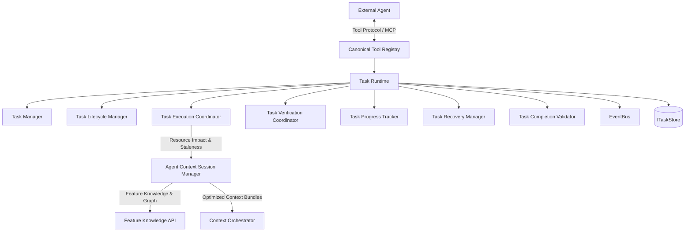
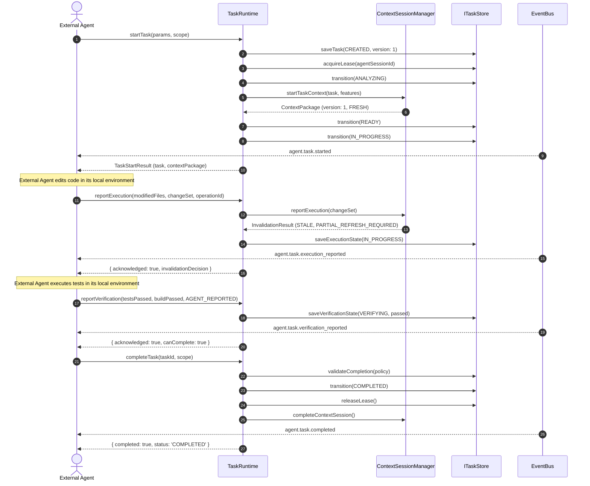

# Task & Session Runtime Architecture (Phase 7.5)

## 1. Overview & System Mission

ProjectMind is strictly an AI-native repository intelligence and context optimization platform. It serves as the repository intelligence backbone and task state coordinator for external agents (e.g., Claude, Cursor, custom agent CLI runners).

### Architectural Boundary
ProjectMind **never** autonomously executes coding tasks, synthesizes code, edits project source files, executes build scripts, runs shell commands, or runs unit tests. The external agent executes code modifications and tests in its host environment, reporting status, changed resources, and verification outcomes back to ProjectMind.

---

## 2. Core Subsystems

| Subsystem | Primary Interface | Responsibility |
| :--- | :--- | :--- |
| **Task Manager** | `ITaskManager` | Task CRUD, optimistic concurrency (`taskVersion`), and lease lifecycle management. |
| **Lifecycle Manager** | `ITaskLifecycleManager` | State progression (`CREATED` -> `ANALYZING` -> `READY` -> `IN_PROGRESS` -> `VERIFYING` -> `COMPLETED`/`FAILED`/`CANCELLED`), transition validation, and audit timeline tracking. |
| **Execution Coordinator** | `ITaskExecutionCoordinator` | Normalizes `AgentChangeSet`, deduplicates operations via idempotency keys, and bridges impact analysis to `IAgentContextSessionManager`. |
| **Verification Coordinator** | `ITaskVerificationCoordinator` | Enforces explicit trust boundaries (`verificationSource: 'AGENT_REPORTED'`), aggregates build/test/lint/typecheck reports, and updates verification state. |
| **Progress Tracker** | `ITaskProgressTracker` | Computes deterministic stage percentages, aggregates completed steps, and renders runtime summaries. |
| **Recovery Manager** | `ITaskRecoveryManager` | Handles agent session reconnects, blocked task resumption, and context staleness checks. |
| **Completion Validator** | `ITaskCompletionValidator` | Evaluates configurable completion policies (`TaskCompletionPolicy`) before allowing terminal `COMPLETED` state. |
| **Task Runtime Orchestrator** | `ITaskRuntime` | Primary facade wiring all subsystems, canonical tool handlers, and MCP adapters. |

---

## 3. Interaction Sequence

---

## 4. Architectural Rules & Constraints

1. **No Autonomous Code Execution**: ProjectMind never modifies workspace files or launches test processes.
2. **Strict Scope Isolation**: Every task belongs to a specific `workspaceId`, `repositoryId`, and `agentSessionId`. Requests across scope boundaries throw `TaskScopeError`.
3. **Optimistic Concurrency**: Stale task updates are rejected with `TaskVersionConflictError` whenever `expectedVersion !== currentVersion`.
4. **Lightweight Leases**: Tasks have short-lived, renewable leases preventing concurrent execution contention across agent sessions.
5. **Event-Driven Integration**: All lifecycle transitions publish events to `IEventBus` using canonical event strings (`agent.task.*`).
