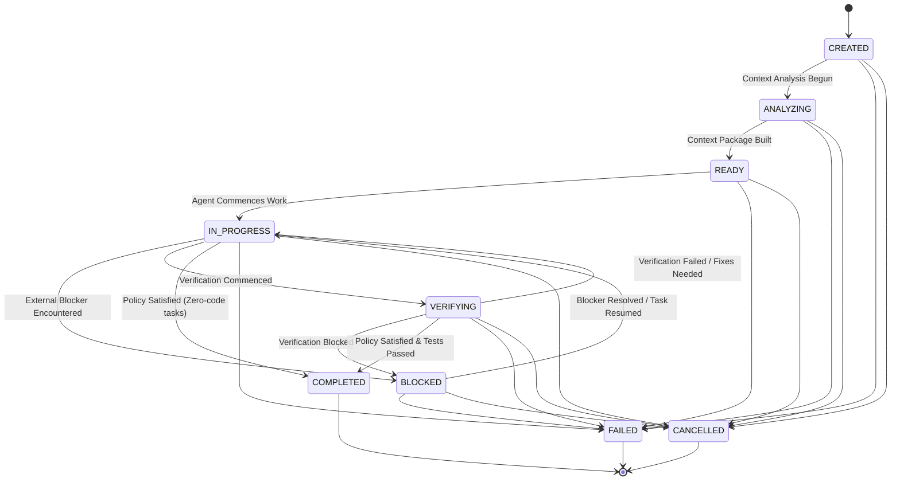

# Task State Machine (Phase 7.5)

## 1. Formal Transition Matrix

The `TaskTransitionValidator` strictly enforces valid state transitions to guarantee task consistency and deterministic lifecycle tracking.

| From State | Allowed Target States | Disallowed / Illegal Transitions |
| :--- | :--- | :--- |
| **`CREATED`** | `ANALYZING`, `FAILED`, `CANCELLED` | `READY`, `IN_PROGRESS`, `VERIFYING`, `COMPLETED` |
| **`ANALYZING`** | `READY`, `FAILED`, `CANCELLED` | `CREATED`, `IN_PROGRESS`, `VERIFYING`, `COMPLETED` |
| **`READY`** | `IN_PROGRESS`, `FAILED`, `CANCELLED` | `CREATED`, `ANALYZING`, `VERIFYING`, `COMPLETED` |
| **`IN_PROGRESS`** | `VERIFYING`, `BLOCKED`, `COMPLETED`, `FAILED`, `CANCELLED` | `CREATED`, `ANALYZING`, `READY` |
| **`BLOCKED`** | `IN_PROGRESS`, `FAILED`, `CANCELLED` | `CREATED`, `ANALYZING`, `READY`, `VERIFYING`, `COMPLETED` |
| **`VERIFYING`** | `COMPLETED`, `IN_PROGRESS`, `BLOCKED`, `FAILED`, `CANCELLED` | `CREATED`, `ANALYZING`, `READY` |
| **`COMPLETED`** | *(Terminal - None)* | Any (Reopening completed tasks throws `TaskLifecycleError`) |
| **`FAILED`** | *(Terminal - None)* | Any |
| **`CANCELLED`** | *(Terminal - None)* | Any |

---

## 2. Transition Guard Logic

### Self-Transitions
A transition from a state to itself (e.g., `IN_PROGRESS` -> `IN_PROGRESS`) is permitted as a no-op to allow heartbeat updates and metadata refreshes without throwing an error.

### Terminal Invariance
Terminal states (`COMPLETED`, `FAILED`, `CANCELLED`) are immutable. Any attempt to transition out of a terminal state throws `TaskLifecycleError`.
