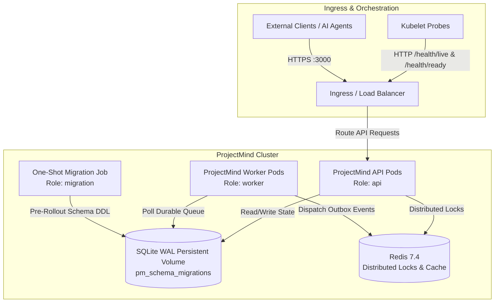

# ProjectMind Platform — Cloud-Native Deployment & Operational Guide

## 1. Overview & Architecture

ProjectMind is an AI-native project memory engine designed to operate safely across development, staging, and production environments. It supports containerized microservice deployments with independent scaling of API, background workers, and migration jobs.



---

## 2. Service Roles & Deployment Topology

ProjectMind supports distinct execution roles specified via the `PROJECTMIND_ROLE` environment variable or the `--role=<role>` CLI flag:

| Role | Container Command | Description | Resource Profile |
| :--- | :--- | :--- | :--- |
| **`migration`** | `node dist/platform/main.js --role=migration` | Runs pending database schema migrations, validates checksums, acquires advisory lock, and exits with code 0 or 1. | CPU: 0.25–1.0 Core<br/>RAM: 256–512 MB |
| **`api`** | `node dist/platform/main.js --role=api` | Serves HTTP API endpoints, readiness/liveness probes, and Prometheus metrics. Handles graceful socket draining on SIGTERM. | CPU: 0.5–1.5 Cores<br/>RAM: 512–1024 MB |
| **`worker`** | `node dist/platform/main.js --role=worker` | Pulls and executes background durable jobs from `pm_durable_jobs`, manages visibility timeout leases, and dispatches outbox events. Exposes health probes on port 3000. | CPU: 0.5–2.0 Cores<br/>RAM: 512–2048 MB |
| **`scheduler`** | `node dist/platform/main.js --role=scheduler` | Periodic maintenance daemon executing non-destructive retention cleanup on terminal jobs and dispatched events. | CPU: 0.25–0.5 Core<br/>RAM: 256–512 MB |
| **`all`** | `node dist/platform/main.js --role=all` | Unified in-process runner combining API, worker pool, and maintenance scheduler. Recommended for local development and single-container deployments. | CPU: 1.0–2.0 Cores<br/>RAM: 1024–2048 MB |

---

## 3. Configuration Reference

All settings are validated at startup using Zod schemas (`PlatformConfigValidator`). Invalid types, out-of-range values, or insecure production configurations trigger fail-fast behavior with structured, secret-redacted error messages.

### Core Settings
| Environment Variable | Default | Valid Values | Description |
| :--- | :--- | :--- | :--- |
| `PROJECTMIND_ENV` | `development` | `development`, `test`, `production` | Deployment environment tier. Enforces production strictness when set to `production`. |
| `PROJECTMIND_ROLE` | `all` | `api`, `worker`, `scheduler`, `migration`, `all` | Runtime process role. |
| `PROJECTMIND_LOG_LEVEL` | `INFO` | `DEBUG`, `INFO`, `WARN`, `ERROR`, `FATAL` | Structured logger verbosity threshold. |
| `PROJECTMIND_LOG_FORMAT` | `json` | `json`, `pretty` | Output log format. `json` is recommended for cloud log collectors. |
| `PROJECTMIND_SECRET_REDACTION_ENABLED` | `true` | `true`, `false` | Redacts API keys, bearer tokens, passwords, and secrets before log output. |

### Server Settings (API & Health)
| Environment Variable | Default | Valid Values | Description |
| :--- | :--- | :--- | :--- |
| `PORT` or `PROJECTMIND_PORT` | `3000` | `0`–`65535` | TCP port for HTTP API server and Kubernetes probes. |
| `HOST` or `PROJECTMIND_HOST` | `0.0.0.0` | IP string | Host interface binding. |
| `PROJECTMIND_CORS_ORIGINS` | `*` | Comma-delimited list | Allowed CORS origins. |
| `PROJECTMIND_REQUEST_TIMEOUT_MS` | `30000` | Integer > 0 | Maximum incoming request execution timeout in milliseconds. |
| `PROJECTMIND_DRAIN_TIMEOUT_MS` | `10000` | Integer > 0 | Maximum time allowed for in-flight requests to complete during graceful shutdown. |

### Worker & Queue Settings
| Environment Variable | Default | Valid Values | Description |
| :--- | :--- | :--- | :--- |
| `PROJECTMIND_WORKER_CONCURRENCY` | `5` | Integer >= 1 | Number of concurrent durable worker execution threads per container. |
| `PROJECTMIND_POLL_INTERVAL_MS` | `250` | Integer > 0 | Interval between polling cycles for ready messages in ms. |
| `PROJECTMIND_VISIBILITY_TIMEOUT_MS` | `30000` | Integer > 0 | Lease duration before unacknowledged messages are reclaimed. |
| `PROJECTMIND_LEASE_RENEWAL_INTERVAL_MS` | `10000` | Integer > 0 | Heartbeat interval for active workers to renew their ownership lease. |

### Storage & Database Settings
| Environment Variable | Default | Valid Values | Description |
| :--- | :--- | :--- | :--- |
| `PROJECTMIND_STORAGE_TYPE` | `memory` | `memory`, `sqlite`, `filesystem` | Storage backend type. Must be `sqlite` in production. |
| `PROJECTMIND_STORAGE_LOCATION` | `.projectmind/data` | Path string | Directory path for SQLite database file and state snapshots. |
| `PROJECTMIND_DATABASE_URL` | `undefined` | Connection string | Optional explicit database path (e.g., `sqlite://.projectmind/data/projectmind.db`). |
| `PROJECTMIND_DATABASE_WAL` | `true` | `true`, `false` | Enables SQLite Write-Ahead Logging (WAL) for high-concurrency read/write operations. |
| `PROJECTMIND_DATABASE_BUSY_TIMEOUT_MS` | `5000` | Integer > 0 | Timeout before busy SQLite transactions throw errors. |
| `PROJECTMIND_AUTO_MIGRATE` | `true` | `true`, `false` | Automatically applies pending migrations on boot. Should be `false` when using migration jobs in production. |

### Distributed Coordination (Redis)
| Environment Variable | Default | Valid Values | Description |
| :--- | :--- | :--- | :--- |
| `PROJECTMIND_REDIS_ENABLED` | `false` | `true`, `false` | Enables Redis backend for multi-instance distributed coordination. |
| `PROJECTMIND_REDIS_URL` or `REDIS_URL` | `undefined` | URL string | Redis connection URL (`redis://[:password@]host:port`). Required if Redis is enabled. |
| `PROJECTMIND_REDIS_KEY_PREFIX` | `projectmind:` | String | Key namespace prefix for distributed locks and cache entries. |

---

## 4. Production Container Image Construction

ProjectMind uses a multi-stage Docker build to keep images minimal and secure:

```bash
# Build the production image locally
docker build -t projectmind:1.0.0 -t projectmind:latest .
```

### Dockerfile Highlights
1. **Pinned Runtime:** Based on `node:20.18.0-bookworm-slim` for reproducible native bindings (`better-sqlite3`, `kuzu`).
2. **Build Isolation:** Compiles TypeScript and runs ESM specifier normalization in Stage 1 (`builder`), discarding devDependencies in Stage 2 (`runner`).
3. **Signal Handling:** Uses `dumb-init` as PID 1 to ensure POSIX signals (`SIGTERM`, `SIGINT`) propagate cleanly to Node.js without orphaned processes.
4. **Least-Privilege Execution:** Executes exclusively under non-root user `USER node` with UID/GID 1000.
5. **Built-in Probes:** Pre-installed `curl` executes health checks against `/health/live`.

---

## 5. Local Multi-Service Deployment (Docker Compose)

To spin up a complete multi-container stack with API, worker, migration, and Redis services:

```bash
# 1. Prepare environment configuration
cp .env.example .env

# 2. Launch the stack
docker compose up -d

# 3. Verify container status
docker compose ps

# 4. Tail structured logs
docker compose logs -f api worker
```

To tear down:
```bash
docker compose down -v
```

---

## 6. Kubernetes Production Deployment

Kubernetes manifests are organized under `deploy/kubernetes/`:

```
deploy/kubernetes/
├── namespace.yaml              # Dedicated 'projectmind' namespace
├── configmap.yaml              # Non-sensitive configuration
├── secret.example.yaml         # Secret template
├── pvc.yaml                    # Persistent volume claim (10Gi ReadWriteOnce)
├── migration-job.yaml          # One-shot migration Job (runs before rollout)
├── api-deployment.yaml         # API deployment (2 replicas, rolling updates)
├── api-service.yaml            # ClusterIP service exposing port 3000
└── worker-deployment.yaml      # Worker deployment (2 replicas)
```

### Deployment Steps

1. **Create Namespace and ConfigMap:**
   ```bash
   kubectl apply -f deploy/kubernetes/namespace.yaml
   kubectl apply -f deploy/kubernetes/configmap.yaml
   ```

2. **Configure Secrets:**
   ```bash
   # Create real production secrets (never commit these)
   kubectl create secret generic projectmind-secrets \
     --namespace projectmind \
     --from-literal=PROJECTMIND_API_KEY="<strong-random-token>" \
     --from-literal=PROJECTMIND_SESSION_SECRET="<strong-random-secret>"
   ```

3. **Provision Persistent Volume Claim:**
   ```bash
   kubectl apply -f deploy/kubernetes/pvc.yaml
   ```

4. **Execute Schema Migrations:**
   ```bash
   kubectl apply -f deploy/kubernetes/migration-job.yaml
   kubectl wait --for=condition=complete job/projectmind-schema-migration --namespace projectmind --timeout=60s
   ```

5. **Deploy API and Background Worker Services:**
   ```bash
   kubectl apply -f deploy/kubernetes/api-deployment.yaml
   kubectl apply -f deploy/kubernetes/api-service.yaml
   kubectl apply -f deploy/kubernetes/worker-deployment.yaml
   ```

6. **Verify Rollout Status:**
   ```bash
   kubectl rollout status deployment/projectmind-api --namespace projectmind
   kubectl rollout status deployment/projectmind-worker --namespace projectmind
   ```

---

## 7. Health, Readiness & Metrics Endpoints

| Endpoint | Method | Response Codes | Description | Orchestrator Use |
| :--- | :--- | :--- | :--- | :--- |
| `/health/live` | `GET` | 200 (Alive), 503 (Dead) | Checks that the Node.js event loop is responsive. Does not fail on transient external outages. | Kubernetes `livenessProbe` |
| `/health/ready` | `GET` | 200 (Ready), 503 (Not Ready) | Checks critical dependencies (database access, storage directory, initialization state). Returns 503 during startup and draining. | Kubernetes `readinessProbe` |
| `/health` or `/v1/health` | `GET` | 200 (Healthy/Degraded), 503 (Unhealthy) | Full diagnostic report with component breakdown, latency ms, and sanitized messages. | Administrative inspection |
| `/metrics` or `/v1/metrics` | `GET` | 200 | Serves Prometheus exposition format when `Accept: text/plain` or `?format=prometheus`, otherwise returns JSON snapshot. | Prometheus scraper / Datadog agent |

---

## 8. Graceful Shutdown & Drain Workflow

When an instance receives a termination signal (`SIGTERM` or `SIGINT`):

1. **Readiness Flips to False:** `/health/ready` immediately begins returning `503 Service Unavailable`, prompting the ingress/load balancer to stop routing new traffic.
2. **Pre-Stop Delay:** A 5-second `preStop` hook in Kubernetes allows in-flight ingress routing changes to propagate.
3. **HTTP Socket Draining:** The server calls `server.close()`, sets `Connection: close` on existing keep-alive connections, and waits up to `PROJECTMIND_DRAIN_TIMEOUT_MS` for active requests to finish.
4. **Worker Lease Finalization:** Background workers stop claiming new jobs and allow in-flight jobs to complete up to `PROJECTMIND_SHUTDOWN_TIMEOUT_MS`.
5. **Resource Closure:** Outbox dispatchers, telemetry collectors, and database connection pools flush buffers and close handles cleanly.
6. **Clean Exit:** Process exits with code 0.

---

## 9. Secret Management & Rotation Runbook

### Key Principles
- Secrets must never be stored in container images, git repositories, or plain-text files.
- All secrets are injected via Kubernetes `Secret` objects or external secret stores.

### Rotation Procedure
1. Generate new credentials in the upstream identity or database provider.
2. Update the Kubernetes secret:
   ```bash
   kubectl create secret generic projectmind-secrets \
     --namespace projectmind \
     --from-literal=PROJECTMIND_API_KEY="<new-token>" \
     --dry-run=client -o yaml | kubectl apply -f -
   ```
3. Trigger a rolling restart of the deployments to pick up the rotated credentials:
   ```bash
   kubectl rollout restart deployment/projectmind-api --namespace projectmind
   kubectl rollout restart deployment/projectmind-worker --namespace projectmind
   ```
4. Verify readiness probes pass on the newly created pods before decommissioning old credentials.

---

## 10. Database Backup, Restore & Migration Recovery

### Backup Procedure
Because SQLite WAL mode is used, backups can be safely created without stopping the database:
```bash
# Safe hot backup using SQLite online backup API or CLI
sqlite3 /app/.projectmind/data/projectmind.db ".backup '/backup/projectmind-backup-$(date +%s).db'"
```

### Migration Failure Recovery
If a schema migration fails:
1. Inspect the migration history in SQLite:
   ```sql
   SELECT * FROM pm_schema_migrations ORDER BY version DESC;
   ```
2. Verify the advisory lock was released:
   ```sql
   SELECT * FROM pm_schema_migrations_lock;
   ```
3. Resolve the underlying error and re-run the migration job. The migration runner is fully idempotent and resumes from the failed migration version.

---

## 11. Troubleshooting Common Issues

### Issue 1: Liveness Probes Failing with 503
- **Cause:** Event loop blocked by excessive CPU operations or out-of-memory condition.
- **Remediation:** Inspect pod memory limits via `kubectl top pod --namespace projectmind`. Increase `limits.memory` in deployment manifest if OOMKilled.

### Issue 2: Readiness Probes Failing
- **Cause:** Database file locked or inaccessible, or storage directory lacks write permissions.
- **Remediation:** Verify volume mount ownership. Ensure container runs as UID 1000 (`USER node`) and `fsGroup: 1000` is configured on the pod securityContext.

### Issue 3: Schema Migration Lock Timeout
- **Cause:** Previous migration container crashed abruptly while holding the lock.
- **Remediation:** The lock automatically expires after 30 seconds (`lockTimeoutMs`). If necessary, manually clear stale lock entries:
  ```bash
  node dist/platform/main.js --role=migration
  ```
