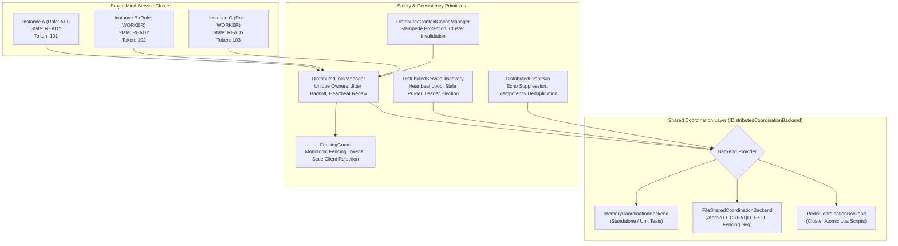
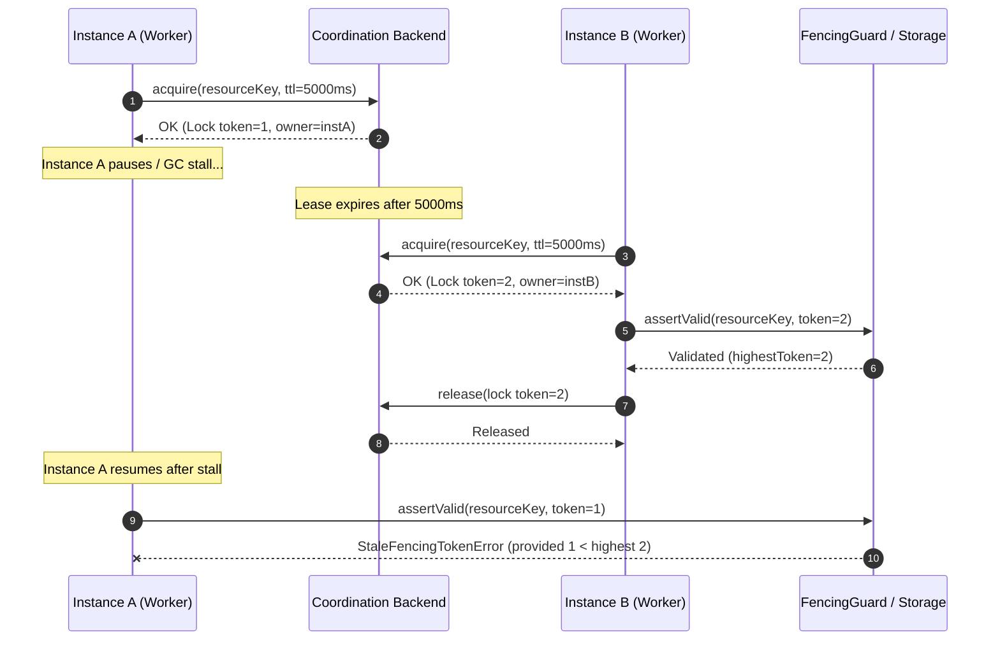
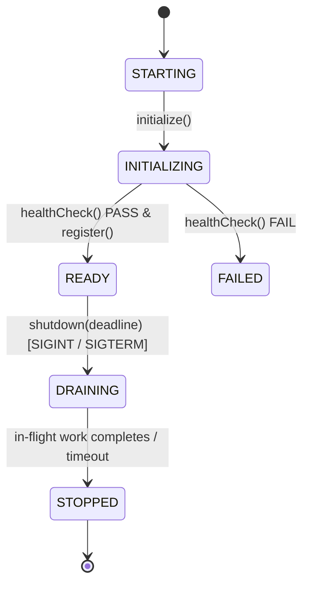

# ProjectMind Distributed Runtime & Multi-Instance Architecture

## 1. Architectural Overview

ProjectMind Phase 10.3 introduces a production-oriented distributed coordination runtime that allows multiple ProjectMind instances (API gateways, workers, hybrid coordinators) to safely share persistent infrastructure while upholding deterministic-first repository intelligence, context cache consistency, and strictly mutual exclusion guarantees.

---

## 2. Distributed Coordination & Locking Guarantees

### 2.1 Core Invariants
1. **Mutual Exclusion**: For any given resource key `K`, at most one instance holds a valid, unexpired lease at any point in time.
2. **Unique Ownership Tokens**: Every acquired lock is stamped with a composite identifier `node-<pid>-<randomUUID>`. An instance cannot release or renew a lock owned by another instance.
3. **Monotonic Fencing Tokens**: Every acquisition increments a shared sequence counter. Any operation interacting with protected resources passes this token to `FencingGuard`. If a delayed or paused client attempts a mutation after another instance has superseded its lease, the write is immediately rejected with `StaleFencingTokenError`.
4. **Bounded Acquisition Timeouts**: No operation waits indefinitely or enters busy spins. Callers specify `waitTimeoutMs` (default: 10,000ms), and failed acquisitions return `{ success: false, error: '...' }` safely.
5. **Background Auto-Renewal**: Long-running operations actively renew their lease at 50% of the TTL interval. If the process is halted or dies, renewal ceases and the lease expires cleanly.
6. **Error-Safe Resource Cleanup**: The `withLock` pattern wraps work in a `try...finally` block to ensure locks are released even on unhandled exceptions.

---

## 3. Service Discovery & Multi-Instance Lifecycle

### 3.1 Lifecycle States

- **`STARTING`**: Instance process launched, configuration loaded.
- **`INITIALIZING`**: Validating coordination backend health, preparing kernel subsystems.
- **`READY`**: Registered in cluster discovery, active heartbeat loop running, work accepted.
- **`DRAINING`**: New work rejected (`canAcceptWork() === false`), in-flight tasks given up to `shutdownTimeoutMs` to conclude, active locks gracefully released.
- **`STOPPED`**: Deregistered from cluster discovery, background timers cleared, backend connection closed.
- **`FAILED`**: Startup aborted due to dependency or coordination failure.

### 3.2 Service Discovery Records
Each active node writes a discovery record containing:
- `instanceId`: Unique instance identifier (`inst-<hostname>-<pid>-<random>`).
- `role`: Service role (`API`, `WORKER`, `COORDINATOR`, `HYBRID`).
- `hostname`: Host machine name.
- `pid`: Process identifier.
- `state`: Current lifecycle state (`READY`, `DRAINING`, `STOPPED`).
- `capabilities`: Array of supported subsystem tags (`['core', 'locking', 'events']`).
- `fencingToken`: Node sequence token.
- `registeredAt`: Registration timestamp.
- `lastHeartbeatAt`: Most recent heartbeat timestamp.

Heartbeats run periodically (`heartbeatIntervalMs`, default 5,000ms). Nodes whose `lastHeartbeatAt` exceeds `staleThresholdMs` (default 15,000ms) are automatically evicted from `getActiveInstances()` and purged.

---

## 4. Shared State & Cache Consistency

### 4.1 Context Cache Stampede Protection
When multiple instances receive concurrent context-resolution requests for the same AST, symbol, or dependency subgraph:
- `DistributedContextCacheManager.getOrCompute()` acquires a distributed lock on `stampede:context:<key>`.
- The first instance to acquire computes the representation, stores it in cache, and releases the lock.
- Competing instances acquire the lock sequentially, check if the cache was populated during wait, and return the cached value without recomputing.

### 4.2 Cluster Cache Invalidation
When repository files are modified, indexed, or deleted:
1. `invalidate(key)` or `clear()` deletes the local in-process cache entry.
2. An invalidation message is broadcast over `DistributedEventBus` to the cluster channel (`pm:cluster:events`).
3. Peer instances receive the invalidation message, match key or prefix, and evict stale local entries immediately.

### 4.3 Event Deduplication & Echo Suppression
- **Echo Suppression**: Events published by instance `A` include `originInstanceId: A`. When the cluster message is received by `A`, it is dropped to prevent redundant self-dispatch.
- **Idempotency Deduplication**: Each event carries a unique `eventId` and `idempotencyKey`. Instances maintain a rolling deduplication window (60 seconds) ensuring duplicated network deliveries trigger handlers at most once.

---

## 5. Configuration & Deployment

### 5.1 Configuration Options
| Environment Variable | Config Property | Type | Default | Description |
| :--- | :--- | :--- | :--- | :--- |
| `PROJECTMIND_DIST_MODE` | `mode` | `'standalone' \| 'distributed'` | `'standalone'` | Execution mode |
| `PROJECTMIND_COORD_BACKEND` | `backend` | `'memory' \| 'file_shared' \| 'redis'` | `'memory'` | Coordination backend provider |
| `PROJECTMIND_INSTANCE_ID` | `instanceId` | `string` | Auto-generated | Instance identifier |
| `PROJECTMIND_SERVICE_ROLE` | `role` | `'API' \| 'WORKER' \| 'COORDINATOR' \| 'HYBRID'` | `'HYBRID'` | Service role |
| `PROJECTMIND_SHARED_DIR` | `sharedDirectory` | `string` | `'.projectmind/coordination'` | Path for `file_shared` backend |
| `PROJECTMIND_REDIS_URL` | `redisUrl` | `string` | `undefined` | Redis connection URL |
| `PROJECTMIND_HEARTBEAT_MS` | `heartbeatIntervalMs` | `number` | `5000` | Discovery heartbeat period |
| `PROJECTMIND_STALE_MS` | `staleThresholdMs` | `number` | `15000` | Stale instance eviction threshold |
| `PROJECTMIND_LOCK_TTL_MS` | `defaultLockTtlMs` | `number` | `30000` | Default lock lease duration |
| `PROJECTMIND_ACQUIRE_TIMEOUT_MS` | `acquireTimeoutMs` | `number` | `10000` | Max acquisition wait timeout |
| `PROJECTMIND_SHUTDOWN_TIMEOUT_MS` | `shutdownTimeoutMs` | `number` | `10000` | Graceful draining deadline |

### 5.2 Deployment Modes
1. **Single-Process Local Development (`mode: 'standalone'`, `backend: 'memory'`)**:
   - Zero external infrastructure required.
   - All locks and pubsub operate in memory.
   - Standard development and single-user CLI commands use this mode.
2. **Multi-Process Local Verification (`mode: 'distributed'`, `backend: 'file_shared'`)**:
   - Coordinates across multiple local Node.js processes using atomic filesystem operations (`O_CREAT | O_EXCL` and atomic file renames).
   - Ideal for multi-process integration testing and CI environments without Redis or Docker.
3. **Multi-Instance Containerized Deployment (`mode: 'distributed'`, `backend: 'redis'`)**:
   - Production multi-node cluster sharing a Redis instance or cluster.
   - Uses atomic Lua scripts for acquisition, renewal, release, and pubsub for instant cluster messaging.

---

## 6. Operational Health & Diagnostics

The CLI and runtime expose structured diagnostics:
- **`node bin/projectmind.js doctor`**: Evaluates system health, workspace integrity, plugin health, memory, and telemetry.
- **`node bin/projectmind.js health`**: Reports component-level health including storage, kernel, and event bus status.
- **`backend.healthCheck()`**: Performs active ping/probe to coordination infrastructure and returns `{ healthy: boolean, latencyMs: number, message: string }`.
