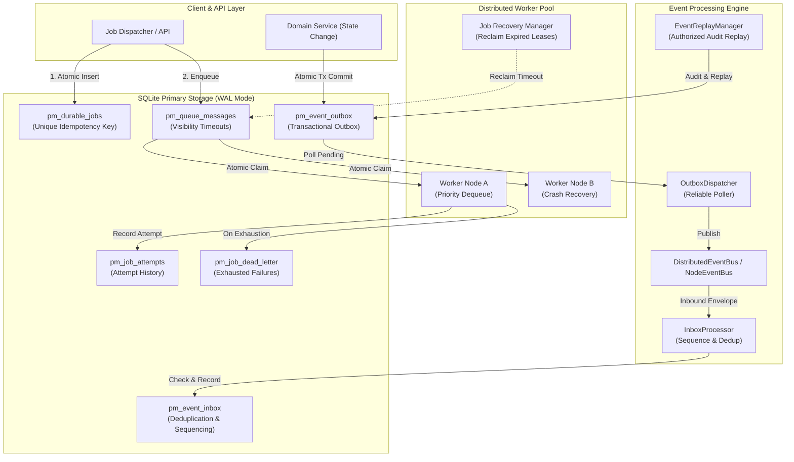
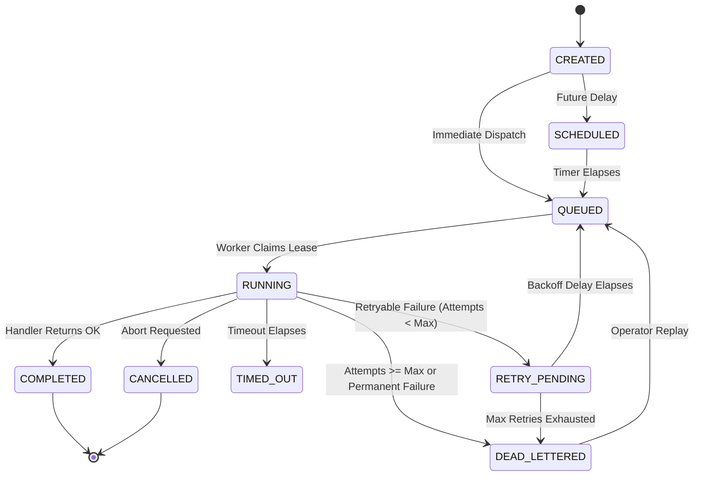
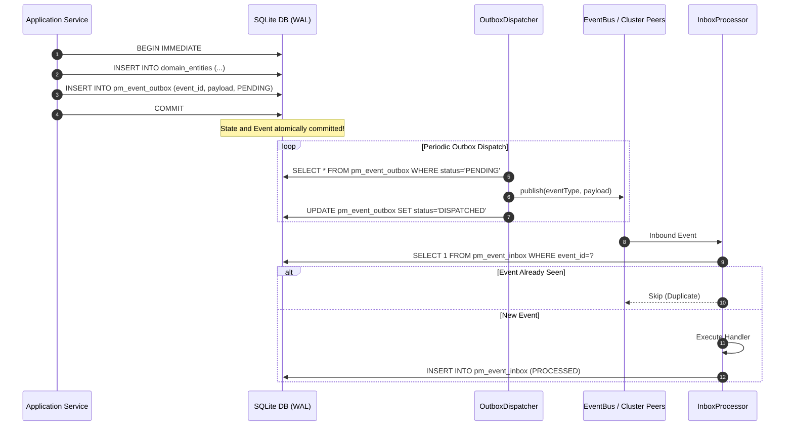

# ProjectMind Durable Jobs & Distributed Event Processing Architecture

## 1. Executive Architectural Overview

ProjectMind Phase 10.4 establishes an enterprise-grade durable job execution and transactional event processing engine. Built directly upon ProjectMind's existing SQLite primary database (operating in WAL mode) and Phase 10.3 distributed coordination primitives, this architecture guarantees:
- **Durable Job Persistence**: Jobs and execution attempts are committed to SQLite tables (`pm_durable_jobs`, `pm_job_attempts`) before acknowledgement, surviving process restarts and abrupt host crashes.
- **Transactional Outbox Pattern**: State mutations and associated events are committed within the same database transaction. The background `OutboxDispatcher` reliably publishes events to the event bus, preventing silent message loss.
- **Transactional Inbox & Deduplication**: Inbound consumers record processed event IDs in `pm_event_inbox`, enforcing at-least-once delivery with strictly idempotent handler execution and per-aggregate sequencing.
- **Multi-Process Worker Pool**: Independent OS worker processes safely compete for work via `DurableJobQueue` with priority weighting (`CRITICAL` > `HIGH` > `NORMAL` > `LOW`), visibility timeouts, and atomic lease acquisition.
- **Failure Recovery & Dead-Letter Handling**: Bounded exponential backoff with jitter, error classification (`RETRYABLE`, `PERMANENT`, `OPERATOR_INTERVENTION`), persistent dead-letter queue (`pm_job_dead_letter`), and authorized replay APIs with comprehensive audit trails (`pm_event_replay_audit`).

---

## 2. Durable Job Model & State Transitions

### 2.1 State Transition Graph

### 2.2 Table Schemas
1. **`pm_durable_jobs`**:
   - `job_id`: Primary key UUID.
   - `type`: Job type identifier (`INDEX_REPOSITORY`, `EXTRACT_REPOSITORY`, etc.).
   - `status`: Current lifecycle state.
   - `priority`: Priority classification (`CRITICAL`, `HIGH`, `NORMAL`, `LOW`).
   - `workspace_id`: Tenant workspace boundary.
   - `organization_id`: Tenant organization boundary.
   - `payload_json`: Validated input parameters (capped at 512KB).
   - `result_json`: Output summary or artifact reference.
   - `error_json`: Classified error details.
   - `idempotency_key`: Unique token per `(workspace_id, idempotency_key)`.
   - `fencing_token`: Monotonically increasing lease token protecting against stale overwrites.
   - `version`: Optimistic concurrency control counter.
2. **`pm_job_attempts`**:
   - Historical ledger tracking each worker execution attempt, start/completion timestamps, worker ID, outcome, and error classification.
3. **`pm_job_dead_letter`**:
   - Quarantine table storing failed jobs that exhausted retries or suffered fatal permanent errors.
   - Tracks `replayed_at`, `replayed_by`, and `replay_count`.

---

## 3. Transactional Outbox & Inbox Event Processing

### 3.1 Transactional Outbox
To solve the dual-write problem between database state changes and asynchronous event notifications, domain operations write domain records and corresponding events into `pm_event_outbox` within the **same SQLite transaction**.

### 3.2 Ordering Guarantees
- **Scope**: Ordered per `(aggregate_type, aggregate_id)`.
- **Mechanism**: Every outbox entry receives an auto-incrementing `aggregate_seq`.
- **Consumer Detection**: `InboxProcessor` checks `lastSeq = inbox.getLastProcessedSeq()`. If `event.aggregateSeq > lastSeq + 1`, the event is flagged as out-of-order, allowing downstream handlers to buffer or log warnings.

---

## 4. Multi-Process Worker Execution & Recovery

1. **Atomic Dequeue**:
   - `DurableJobQueue.dequeue(visibilityTimeoutMs)` runs within a database transaction.
   - Reclaims any expired in-flight messages (`visible_after_ms <= now`).
   - Selects the highest priority message (`ORDER BY priority_weight DESC, available_at_ms ASC`).
   - Marks status `IN_FLIGHT`, issues a unique `receipt_handle`, and increments `delivery_count`.
2. **Worker Crash Recovery**:
   - If a worker process crashes or exits abruptly (`SIGKILL`), the receipt handle is never acknowledged.
   - Once `visibilityTimeoutMs` expires, subsequent calls to `dequeue()` automatically reclaim the message and return it to active workers with incremented `delivery_count`.
3. **Stale Worker Result Rejection**:
   - If a stalled worker attempts to update job status or result after its lease expired and was reassigned, the database update checks `WHERE job_id = ? AND version = ?`.
   - The stale worker update yields 0 changes and is safely rejected.

---

## 5. Security & Tenant Isolation

- **Workspace & Org Scoping**: Every query in `SqliteJobRepository` and `SqliteTransactionalOutbox` includes `workspace_id` and `organization_id`. `TenantIsolationGuard` asserts caller authorization before job submission or status access.
- **Payload Safety**:
  - Maximum payload size is enforced (512 KB cap) to prevent database bloat and memory denial-of-service.
  - Payloads are scanned for forbidden prototype pollution keys (`__proto__`, `constructor`) and prohibited command injection strings (`/bin/sh`, `cmd.exe`).
- **Secret Redaction**: `JobAuthorizationValidator` recursively redacts password, token, api_key, and private_key fields before persistence.

---

## 6. Retention & Replay Policies

### 6.1 Retention Configuration
`JobRetentionService` runs scheduled or on-demand purges according to configured policy:
- `completedJobsRetentionDays`: Default 14 days (deletes only `COMPLETED` and `CANCELLED` jobs).
- `dispatchedOutboxRetentionDays`: Default 7 days (deletes only `DISPATCHED` events).
- `processedInboxRetentionDays`: Default 14 days.
- `replayedDeadLetterRetentionDays`: Default 30 days.

> **Safety Invariant**: Under no circumstances does `JobRetentionService` remove active (`QUEUED`, `RUNNING`, `SCHEDULED`) jobs, pending outbox events, or un-replayed dead-letter records.

### 6.2 Authorized Event Replay
`EventReplayManager.replayEvents(criteria, initiatedBy, reason)`:
- Enforces operator authentication and non-empty operational reason.
- Enforces maximum batch cap (default 100, max 500) to prevent replay storms.
- Re-marks matching historical outbox events as `PENDING`.
- Records complete audit metadata in `pm_event_replay_audit`.

---

## 7. Operational Observability

The job and event system exposes real-time structured metrics:
- `queue.getDepth()`: Current ready backlog size.
- `outbox.getDepth()`: Pending outbound event backlog.
- `dlq.getDepth()`: Unresolved dead-letter count.
- `inbox.getProcessedCount(consumerName)`: Total deduplicated event throughput per consumer.
- Worker pool metrics: Active workers, completed count, failure count.
