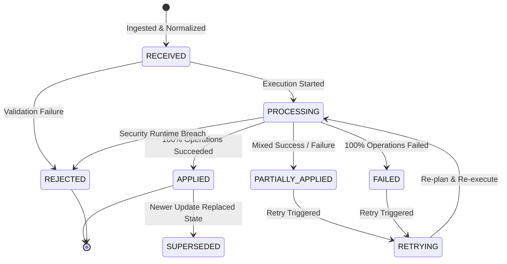

# Knowledge Update Lifecycle & State Machine

## Update States

Each knowledge update progresses through a strict, deterministic state machine:

| Status | Description | Terminal? | Next States |
| :--- | :--- | :--- | :--- |
| `RECEIVED` | Update has been received, normalized, and persisted. | No | `PROCESSING`, `REJECTED` |
| `PROCESSING` | Plan is generated and operations are being executed. | No | `APPLIED`, `PARTIALLY_APPLIED`, `FAILED`, `REJECTED` |
| `APPLIED` | All planned operations executed successfully; versions/invalidations recorded. | Yes | None |
| `PARTIALLY_APPLIED` | Some operations succeeded, others failed. Eligible for partial retry. | Semi | `PROCESSING` (on retry) |
| `FAILED` | All operations failed execution. Eligible for retry. | Semi | `PROCESSING` (on retry) |
| `REJECTED` | Security or scope validation failed. Non-retryable. | Yes | None |
| `SUPERSEDED` | Deprecated by a more recent update for the same targets. | Yes | None |
| `RETRYING` | A previous failure is actively being retried. | No | `PROCESSING` |

## State Transition Diagram

## Batch Run Lifecycle

When multiple updates are processed together (e.g. batch observations via `processKnowledgeUpdates`):

1. **Run Initialization**: `startRun(repositoryId, workspaceId, updateIds)` creates a `KnowledgeUpdateRun` in status `RUNNING`.
2. **Deduplication**: In-memory duplicate filtering within the batch.
3. **Serial/Isolated Processing**: Updates are processed sequentially or by dependency rank.
4. **Aggregate Status Resolution**:
   - All succeeded $\rightarrow$ `COMPLETED`
   - Some succeeded, some failed $\rightarrow$ `PARTIALLY_COMPLETED`
   - All failed $\rightarrow$ `FAILED`
5. **Run Completion**: `completeRun(runId, status, appliedCount, failedCount, versionId)` saves final duration, metrics, and timestamps.
