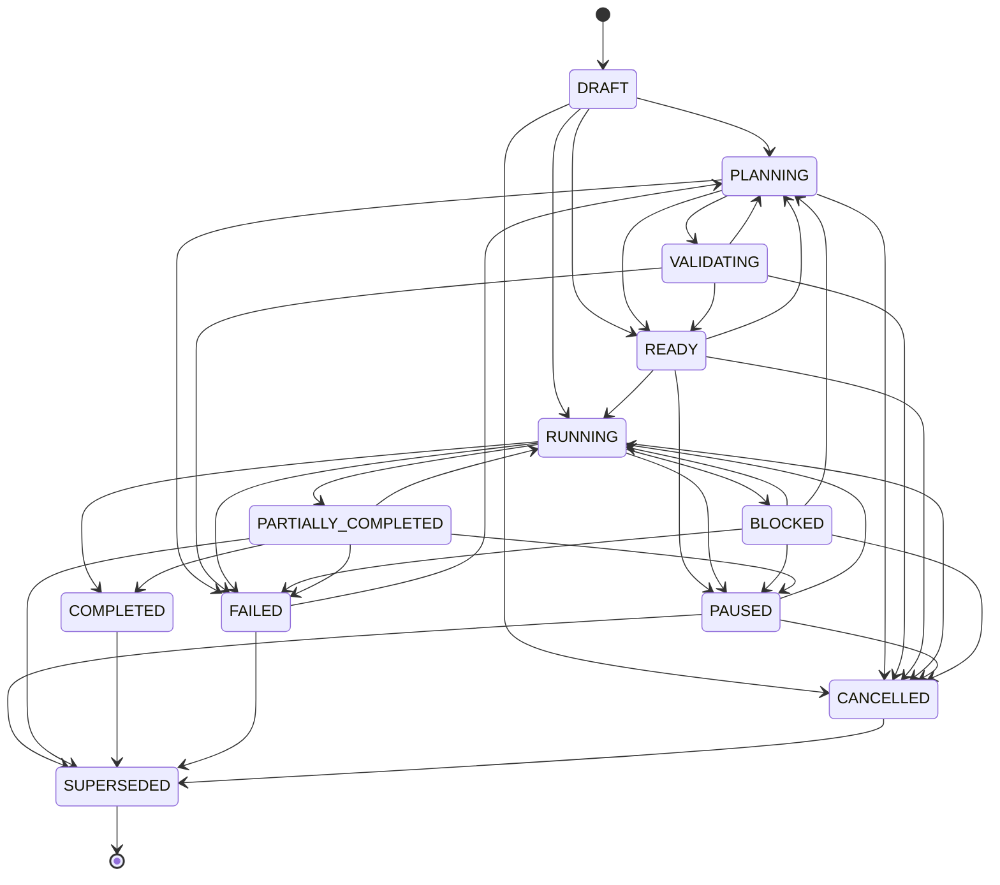

# Plan Lifecycle & Orchestration State Machine

## 1. Plan States and Transitions

The canonical Task Plan lifecycle is strictly modeled in [TaskPlanStatus.ts](file:///c:/Users/Mummy/Desktop/bakwas/ProjectMind/src/agent/planning/models/TaskPlanStatus.ts). Arbitrary mutations are rejected by `assertLegalTransition`.

---

## 2. Task Node State Machine

Each individual step in a plan follows the state machine defined in [TaskNodeStatus.ts](file:///c:/Users/Mummy/Desktop/bakwas/ProjectMind/src/agent/planning/models/TaskNodeStatus.ts):

| State | Semantic Description |
|---|---|
| `PENDING` | Initial state. Prerequisites and upstream dependencies not yet evaluated. |
| `WAITING_FOR_DEPENDENCY` | Blocked because one or more upstream DAG nodes are not yet `COMPLETED`. |
| `WAITING_FOR_APPROVAL` | Human or security policy approval gate is pending decision. |
| `WAITING_FOR_AGENT` | Eligible to run, waiting for an active agent matching required capabilities. |
| `WAITING_FOR_CONTEXT` | Waiting for context orchestrator package resolution. |
| `READY` | All dependencies met, approvals granted, ready for execution dispatch. |
| `IN_PROGRESS` | Bound to an active agent executing via Agent Runtime. |
| `VERIFYING` | Agent execution succeeded; awaiting automated verification evidence. |
| `COMPLETED` | Execution and verification requirements satisfied with verifiable proof. |
| `FAILED` | Execution or verification failed; retry budget exhausted. |
| `BLOCKED` | Explicitly halted due to resource reservation conflict or policy rejection. |
| `CANCELLED` | Task abandoned due to parent plan cancellation or manual override. |
| `STALE` | Downstream of a modified or invalidated repository resource. |
