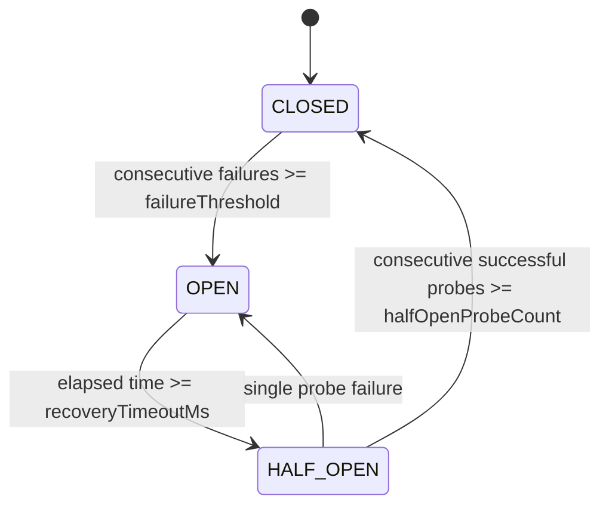

# ProjectMind Circuit Breakers

ProjectMind implements provider-neutral circuit breakers to isolate fragile or degraded external dependencies and prevent cascading thread/worker pool exhaustion.

## 1. Circuit Breaker States

1. **CLOSED**:
   - Normal operating state.
   - Operations execute unimpeded.
   - Consecutive failure counter resets on every successful execution.

2. **OPEN**:
   - Unhealthy dependency detected.
   - All incoming calls **fast-fail immediately** with `CircuitOpenError` without reaching the downstream network.
   - Prevents blocking threads, worker pool saturation, and overwhelming failing dependencies.

3. **HALF_OPEN**:
   - Entered automatically after `recoveryTimeoutMs` has elapsed.
   - Admits a limited number of test probe calls (`halfOpenProbeCount`, default 2).
   - If all probe calls succeed, circuit resets to **CLOSED**.
   - If any probe fails, circuit trips back to **OPEN** immediately.

## 2. Applicability Boundaries

- **Used For**:
  - External AI / LLM provider endpoints (e.g. OpenAI, Anthropic, Gemini).
  - External Git host integrations (GitHub / GitLab API calls).
  - Telemetry / OpenTelemetry export endpoints.
  - Remote vector / graph database instances.
  - Network-backed queue brokers.

- **NOT Used For**:
  - Ordinary in-memory routines.
  - Local disk operations.
  - Security, authentication, or token validation boundaries (circuit breakers must never bypass security).

## 3. Configuration Defaults

| Parameter | Default Value | Description |
| :--- | :--- | :--- |
| `failureThreshold` | 5 | Consecutive failures before tripping to `OPEN` |
| `recoveryTimeoutMs` | 30,000 ms (30s) | Time to wait before entering `HALF_OPEN` probing |
| `halfOpenProbeCount`| 2 | Consecutive successful calls required to close circuit |
