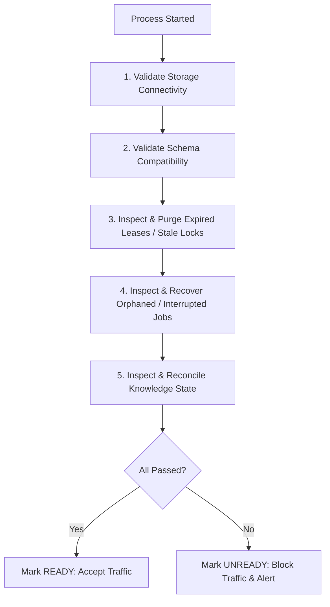

# ProjectMind Startup Recovery, Reconciliations & Graceful Shutdown

ProjectMind guarantees deterministic recovery upon application startup and cleanly bounds execution upon shutdown.

## 1. Startup Recovery Sequence

Before becoming `READY` to receive HTTP or worker traffic, `StartupRecoveryManager` executes the following checklist:

1. **Storage Connectivity**: Verifies primary datastore is reachable and read-write capable.
2. **Schema Compatibility**: Verifies storage schema version matches application binary version.
3. **Stale Lock Recovery**: Uses `StaleLockRecoveryManager` (Phase 8.7) to sweep expired resource locks and leader leases whose TTLs have elapsed.
4. **Job Recovery**: Uses `JobRecoveryManager` (Phase 8.6) to inspect jobs left in `RUNNING` or `QUEUED` state after an ungraceful crash, re-queuing recoverable jobs and dead-lettering jobs that exceeded max attempts.
5. **Knowledge Reconciliation**: Uses `KnowledgeReconciliationService` to inspect repository knowledge versions for missing or partial derived feature states, queueing idempotent feature mapping jobs.

## 2. Safe Self-Healing Boundaries

| Operation | Automation Allowed? | Justification |
| :--- | :---: | :--- |
| **Requeue Expired Job** | **YES** | Safe; job is idempotent and bounded by retry limit |
| **Purge Expired Lock** | **YES** | Safe; lock TTL expired and owner heartbeat lost |
| **Invalidate Stale Cache** | **YES** | Safe; cache is non-authoritative |
| **Queue Missing Feature Analysis** | **YES** | Safe; derived feature generation is non-destructive |
| **Delete Unknown Data** | **NO** | Dangerous; requires explicit operator investigation |
| **Rewrite Corrupted Knowledge** | **NO** | Dangerous; requires human or verification consensus |
| **Automatic Database Restore** | **NO** | Dangerous; never auto-restore production databases |

## 3. Bounded Graceful Shutdown

The `GracefulShutdownCoordinator` coordinates platform termination across 7 bounded steps:
1. `mark_not_ready`: Signals readiness probes to remove node from load balancer rotation.
2. `stop_accepting_work`: Halts incoming external API and event ingestion.
3. `stop_schedulers`: Pauses background cron and job scheduling timers.
4. `drain_workers`: Allows in-flight worker tasks to finish up to `drainTimeoutMs` (default 15s).
5. `release_leases`: Relinquishes active coordination locks and steps down cluster leadership.
6. `flush_telemetry`: Flushes pending metrics and tracing buffers to collectors.
7. `close_connections`: Cleanly terminates storage, database, and broker sockets.
