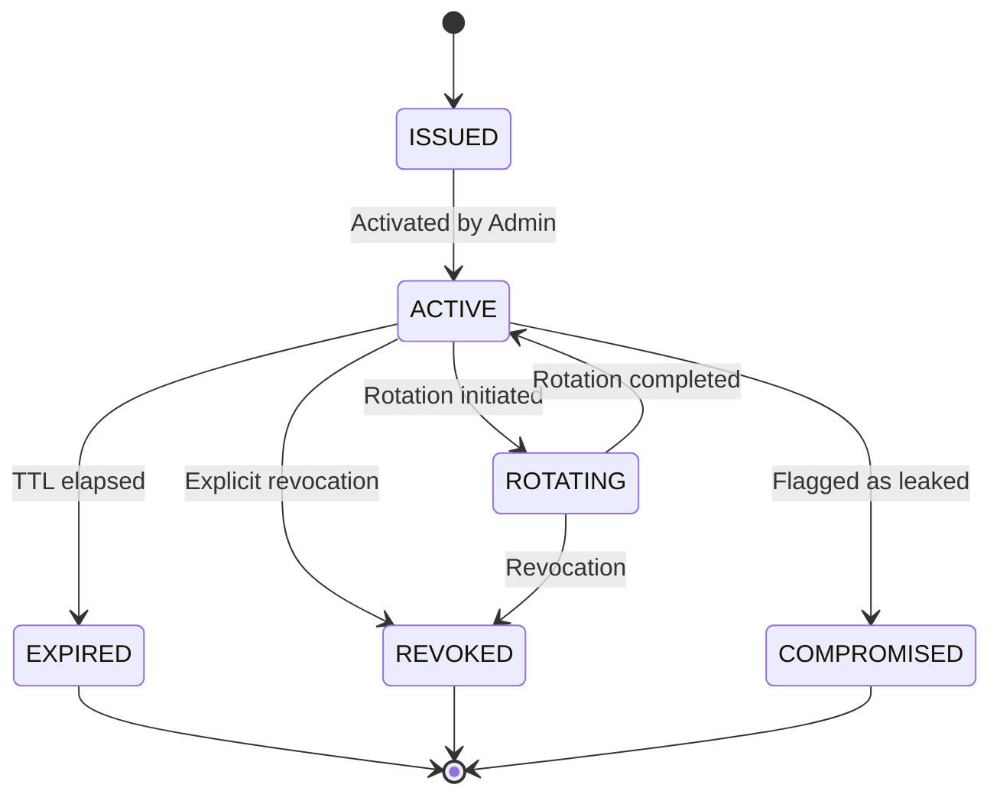

# ProjectMind Authentication & Session Security (Phase 8.9)

## 1. Authentication Mechanisms

ProjectMind supports provider-neutral authentication methods:

| Method | Intended Caller | Validation Mechanism | Production Rules |
| :--- | :--- | :--- | :--- |
| `API_KEY` | Developer / External Agent | Token lookup via `PrincipalResolver` & `CredentialLifecycleManager` | Key must be active; revoked/compromised keys rejected |
| `SESSION` | Interactive Web / IDE Plugin | Session state validated by `SessionManager` | Must be non-expired, unrevoked, and match identity security version |
| `SERVICE_CREDENTIAL` | Background Worker / CI Integration | Mutual service token lookup | Requires verified service identity; scoped to designated workspace |
| `LOCAL_DEVELOPMENT` | Offline unit tests / local dev | Static developer principal | **Strictly prohibited in production** (`PROD_DEV_AUTH_FORBIDDEN`) |

## 2. Credential Lifecycle

Managed through `CredentialLifecycleManager`:

- **Revocation**: Immediately blocks any subsequent authentication attempt.
- **Compromise Flagging**: Marks credential compromised, blocks auth, and generates a critical security incident.

## 3. Session Security & Invalidation

Managed through `SessionManager`:
- **Bounded Inactivity TTL**: Default 1 hour (`3600000ms`); extended on valid touch operations.
- **Identity Security Versioning**: Every identity has a monotonic security version integer. When a user changes their password or reports account compromise, `SessionManager.invalidateAllForIdentity` increments the version. All prior sessions are invalidated simultaneously without database table scans.
