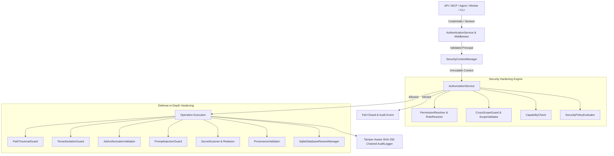

# ProjectMind Enterprise Security & Operational Governance Architecture (Phase 10.8)

## 1. Overview & Security Mission

ProjectMind is an enterprise-grade AI-native repository intelligence platform. It operates as the authoritative context, coordination, and memory plane between external AI coding agents (Windsurf, Cursor, Devin, Gemini CLI, Claude Code) and software repositories.

Phase 10.8 consolidates and hardens a comprehensive defense-in-depth security and operational governance baseline across all platform subsystems:

---

## 2. Security Context & Identity Pipeline

Every protected operation resolves an immutable `SecurityContext`:
1. **Principal**: Authenticated identity (`USER`, `AGENT`, `SERVICE`, or `SYSTEM`).
2. **Authentication Method**: `API_KEY`, `SESSION`, `SERVICE_CREDENTIAL`, `OAUTH`, `JWT`.
3. **Fail-Closed Development Auth**: `LOCAL_DEVELOPMENT` mode and `x-dev-principal-id` headers are strictly forbidden in `production` and `staging` environments.
4. **Workspace & Repository Scope**: Strict multi-tenant resource boundaries validated via `CrossScopeGuard`.
5. **Permissions**: Effective permissions resolved deterministically from assigned roles.
6. **Capabilities**: Technical tool capabilities supported by the caller.
7. **Trust Level**: `UNTRUSTED`, `LIMITED`, `STANDARD`, `VERIFIED`, `SYSTEM`.

---

## 3. Defense-in-Depth Layer Boundaries

### 1. Transport & Network Layer
- **Enterprise Security Headers**: Default attachment of `X-Content-Type-Options: nosniff`, `X-Frame-Options: DENY`, `Strict-Transport-Security: max-age=31536000; includeSubDomains`, `Content-Security-Policy: default-src 'self'`, `Referrer-Policy: strict-origin-when-cross-origin`, `X-XSS-Protection: 0`.
- **CORS Protection**: Origin validation with explicit origin reflection when credentials are used; strict rejection of wildcard `*` origins with `allowCredentials: true` (W3C CORS standard).
- **Payload Limits**: Max body size enforced via streaming byte counters (default 10MB); excess payloads destroy socket immediately.

### 2. Identity & Credential Lifecycle Layer
- **Session Validation**: Enforces expiration (`expiresAt`), active status, revocation checks, and identity security versions (`SessionManager`).
- **Credential Lifecycle**: Supports `ISSUED`, `ACTIVE`, `ROTATING`, `REVOKED`, `EXPIRED`, `COMPROMISED`. Stale, revoked, or compromised credentials fail closed (`CredentialLifecycleManager`).
- **Error Sanitization**: `ApiErrorMapper` filters all outgoing error messages and stack traces through `ConfigRedactor` to prevent accidental credential, token, or connection-string leaks.

### 3. Tenant & Workspace Isolation
- **Scope Containment**: Every database query, vector lookup, and cache entry enforces workspace and repository scope.
- **Cache Isolation**: All cache keys are canonicalized with tenant namespaces: `ws:{workspaceId}:repo:{repoId}:{key}`.
- **Negative Cross-Tenant Checks**: Automated tests verify that tenant A cannot access tenant B's objects, repositories, or cache keys.

### 4. Filesystem & Path Traversal Guard
- **`PathTraversalGuard`**: Validates file paths against authorized repository/workspace roots. Rejects directory traversal escapes (`../..`), null bytes (`\0`), raw system roots (`/etc`, `/var`, `C:\Windows`), and prefix collisions (`/workspace` vs `/workspace_attacker`).
- **`FilesystemValidator`**: Enforces strict boundary verification with explicit path separators.

### 5. Durable Jobs & Worker Security
- **`TenantIsolationGuard`**: Enforces payload size limits (512KB max), rejects prototype pollution (`__proto__`, `constructor.prototype`), and blocks executable shell patterns (`/bin/sh`, `cmd.exe /c`).
- **`JobAuthorizationValidator`**: Validates caller workspace scope against target job workspace, and scans job payloads to reject raw secrets or passwords.

### 6. Backup & Recovery Access Controls
- **`SqliteDatabaseRestoreManager`**: Requires explicit operational authorization (`authorizedBy`).
- **Production Overwrite Protection**: Destructive restore over active production databases is blocked unless `confirmProductionOverwrite: true` is explicitly provided.
- **Integrity Validation**: Computes and validates SHA-256 backup checksums and SQLite `quick_check` integrity before restore.

### 7. Tamper-Aware Cryptographic Audit Logging
- **`AuditLogger`**: Records actor, action, target, result, timestamp, and correlation ID.
- **SHA-256 Hash Chaining**: Each audit record contains `sequenceNumber`, `previousHash`, and `hash` computed over canonical event fields.
- **Integrity Probing**: `verifyIntegrity()` method mathematically verifies the hash chain and pinpoints sequence gaps, deletions, or data mutations.
