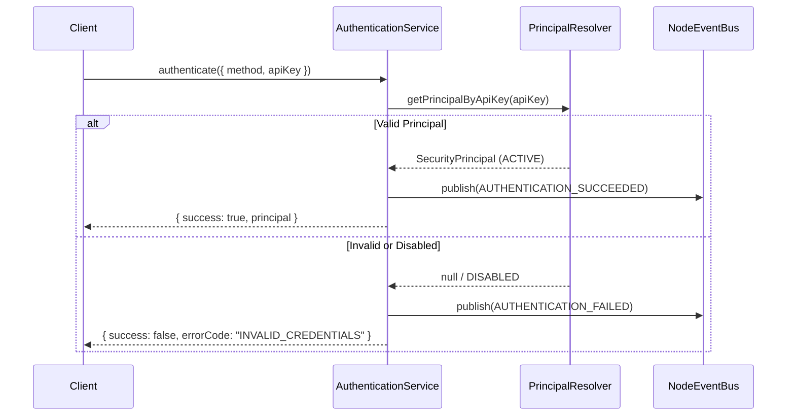

# Phase 8.2 Authentication Guide

## 1. Supported Authentication Methods

The `AuthenticationService` provides authentication for diverse actors across enterprise development:

| Method | Intended For | Description | Production Behavior |
| :--- | :--- | :--- | :--- |
| `API_KEY` | External Agents, CI/CD | Static secret or hash mapped to an active `SecurityPrincipal`. | Required. Fails closed if missing. |
| `TOKEN` | Web UI, REST Clients | Signed JWT or session token. | Verified against expiration & signature. |
| `SESSION` | Interactive sessions | Validated active session ID. | Must map to active session in `SecurityContextManager`. |
| `SERVICE_CREDENTIAL` | Internal microservices | Mutual service account credentials. | Bound to internal service identities. |
| `LOCAL_DEVELOPMENT` | Offline dev environments | Allows unauthenticated developer mode. | **Disabled in production**. Throws if used. |

---

## 2. Authentication Flow

---

## 3. Production Hardening Rules

1. **No External SYSTEM Claims**: External authentication payloads specifying `method: 'SYSTEM'` are unconditionally rejected with `SYSTEM_AUTH_REJECTED`.
2. **Fail-Closed on Unauthenticated Calls**: If `authRequired: true` (default in production), any missing credential immediately fails.
3. **Audit Trail**: Every authentication attempt (success and failure) generates an audit log entry.
