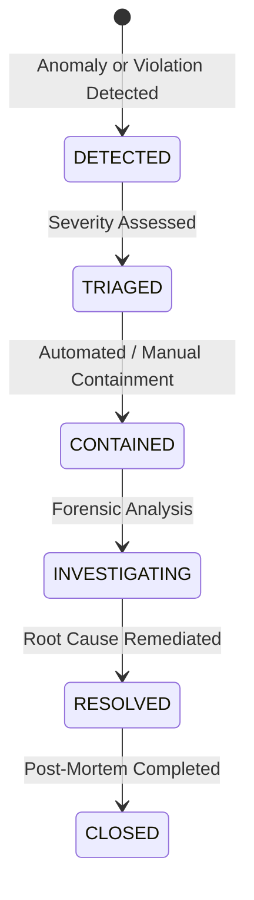

# ProjectMind Incident Response Foundation (Phase 8.9)

## 1. Incident Lifecycle

ProjectMind manages security incidents through `SecurityIncidentManager`:

## 2. Canonical Incident Categories

1. `UNAUTHORIZED_ACCESS`: Brute force, unauthorized API token use, IDOR attempt.
2. `CREDENTIAL_COMPROMISE`: Leaked key detected in public repository or pasted token.
3. `DATA_EXPOSURE`: Cross-workspace data leaked or unauthorized context request.
4. `PRIVILEGE_ESCALATION`: Role escalation or unauthorized permission grant.
5. `MALICIOUS_AGENT`: Agent attempting to execute malicious commands or probe boundaries.
6. `PROMPT_INJECTION`: Hostile directives detected in repository documentation or issues.
7. `INTEGRITY_VIOLATION`: Checksum mismatch or corrupted state detected.
8. `PROVENANCE_VIOLATION`: Forged CI or system provenance claim rejected.
9. `RECOVERY_ABUSE`: Unauthorized or uncoordinated restore operation attempted.
10. `CONFIGURATION_SECURITY`: Production started with insecure debug defaults.
11. `DEPENDENCY_SECURITY`: Vulnerable package or supply-chain anomaly detected.
12. `UNKNOWN`: Unclassified anomaly.

## 3. Safe Containment vs Prohibited Actions

- **Safe Automated Containment Allowed**:
  - `REVOKE_SESSION`: Invalidate active user or agent session.
  - `DISABLE_CREDENTIAL`: Revoke compromised API key.
  - `STOP_JOB`: Terminate unauthorized background job execution.
  - `INVALIDATE_CACHE`: Purge affected cache partition.
- **Strictly Prohibited Automated Actions**:
  - Never automatically delete audit logs.
  - Never automatically delete repositories or files.
  - Never automatically trigger full production database restore.
  - Never modify broad RBAC policies automatically without human review.
