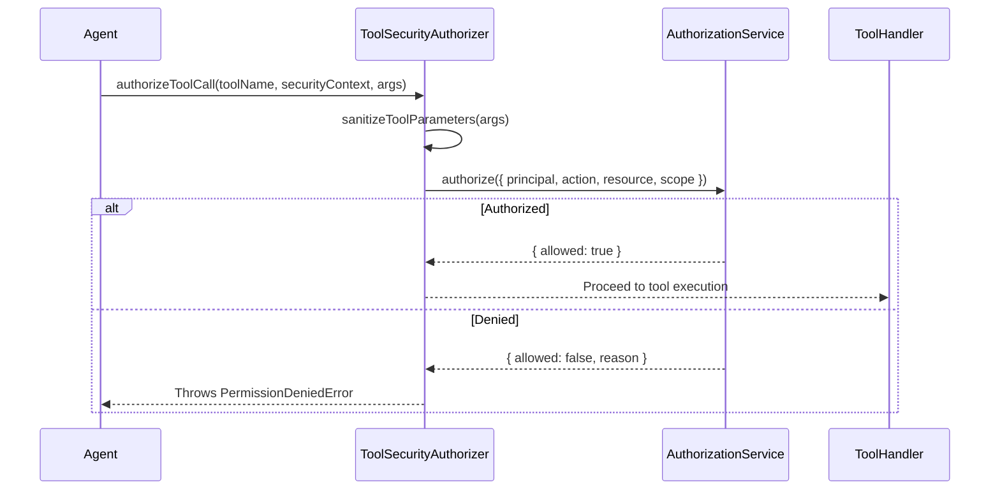

# Phase 8.2 Canonical Tool Security

## 1. Overview

External agents interact with ProjectMind exclusively through canonical tools (Phase 7.3 Tool Protocol) and MCP endpoints (Phase 7.4).

The `ToolSecurityAuthorizer` intercepts all tool requests and ensures:
1. The tool call is mapped to an explicit `PermissionAction` and `ResourceType`.
2. The caller's `SecurityPrincipal` possesses that permission in the target scope.
3. Arguments do not violate tenant boundaries or attempt shell execution.
4. Parameters containing credentials are sanitized.

---

## 2. Tool Permission Mappings

| Tool Name | Action | ResourceType | Required Role Level |
| :--- | :--- | :--- | :--- |
| `projectmind_get_context` | `READ` | `CONTEXT` | `MEMBER`, `AGENT` |
| `projectmind_query_features` | `READ` | `FEATURE` | `MEMBER`, `AGENT` |
| `projectmind_report_execution` | `REPORT` | `OBSERVATION` | `MEMBER`, `AGENT` |
| `projectmind_report_verification`| `REPORT`| `VERIFICATION`| `MEMBER`, `AGENT` |
| `projectmind_update_knowledge` | `UPDATE` | `KNOWLEDGE` | `MAINTAINER`, `OWNER` |
| `projectmind_admin_workspace` | `ADMINISTER`| `WORKSPACE` | `OWNER`, `SUPER_ADMIN` |

---

## 3. Enforcement Pipeline

