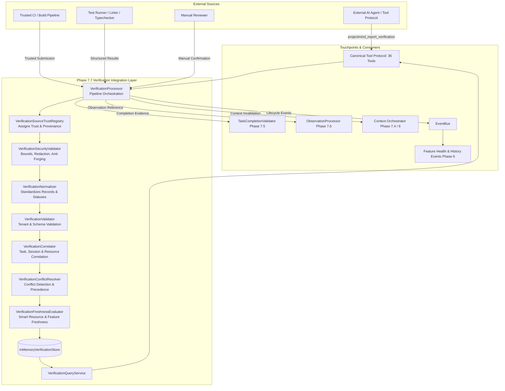
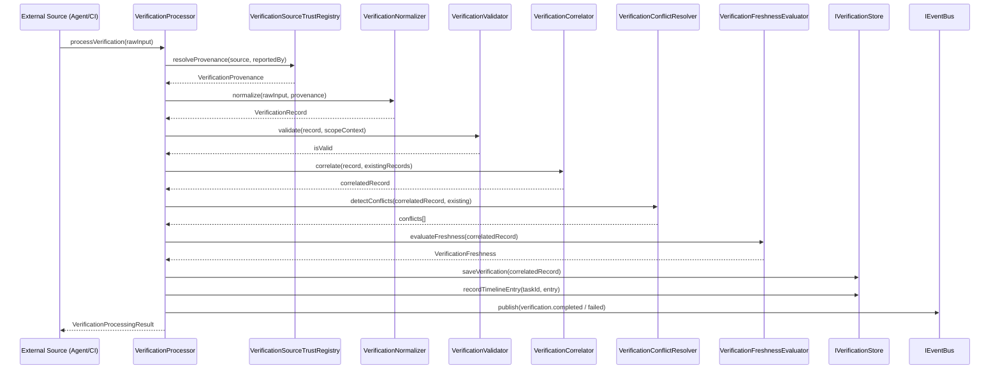

# Verification Architecture — ProjectMind Phase 7.7

ProjectMind is an AI-native repository intelligence and context optimization platform. In Phase 7.7, ProjectMind introduces the **Verification Integration layer**, designed to represent, normalize, correlate, and reason about verification evidence originating from external AI agents, trusted CI/CD pipelines, build systems, test runners, linters, typecheckers, and static analyzers.

---

## 1. Core Architectural Principle

ProjectMind maintains a strict separation of concerns across five distinct concepts:

| Concept | Definition | Example |
|---|---|---|
| **REPORT** | An external entity makes a claim about an execution outcome. | *"Agent says integration tests passed."* |
| **OBSERVATION** | ProjectMind records that a report or event was observed. | *"Received TEST_COMPLETED observation."* |
| **VERIFICATION EVIDENCE** | Structured outcome bound to a specific repository state & scope. | *"Integration tests PASSED for commit `a1b2c3`."* |
| **TRUSTED VERIFICATION** | Independent, authoritative confirmation by a verified system. | *"CI run #402 independently confirmed PASSED."* |
| **COMPLETION** | Task satisfies configured verification & completion policies. | *"Task ready to complete: tests + build verified."* |

> [!IMPORTANT]
> **Zero Autonomous Execution**:
> ProjectMind is repository intelligence; it does **NOT** run tests, execute builds, invoke linters or typecheckers, or execute shell commands. All verification evidence is consumed as structured data from external agents, IDEs, or trusted CI integrations.

---

## 2. Verification Subsystem Architecture

---

## 3. Verification Processing Lifecycle

Every incoming verification report passes through an 8-stage bounded pipeline:

---

## 4. Key Subsystem Components

| Component | Interface | Description |
|---|---|---|
| **VerificationProcessor** | `IVerificationProcessor` | Primary pipeline orchestrator ensuring idempotency, security validation, normalization, and persistence. |
| **VerificationSourceTrustRegistry** | `IVerificationSourceTrustRegistry` | Maps external sources to trust tiers and prevents client-forged trust escalation. |
| **VerificationNormalizer** | `IVerificationNormalizer` | Standardizes raw input into canonical `VerificationRecord` without converting missing data into false certainty. |
| **VerificationValidator** | `IVerificationValidator` | Enforces tenant boundaries (`workspaceId`, `repositoryId`), schema conformity, and payload bounds. |
| **VerificationCorrelator** | `IVerificationCorrelator` | Correlates verification with tasks, sessions, resources, and feature nodes using a 7-tier priority ladder. |
| **VerificationConflictResolver** | `IVerificationConflictResolver` | Detects opposing outcomes between sources and applies strict source precedence rules. |
| **VerificationFreshnessEvaluator** | `IVerificationFreshnessEvaluator` | Smart freshness evaluation comparing repository changes against verified resources and features. |
| **VerificationQueryService** | `IVerificationQueryService` | Exposes bounded, paginated query methods for verifications, summaries, timelines, and completion evidence. |
| **InMemoryVerificationStore** | `IVerificationStore` | Thread-safe in-memory store indexed by `verificationId`, `taskId`, `operationId`, and tenant scope. |
