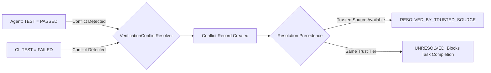

# Verification Conflicts — ProjectMind Phase 7.7

In a multi-agent or hybrid development environment, different sources may report contradictory verification results for the same task or commit (for example, an AI agent reports unit tests passed locally, but the CI pipeline reports test failure). Phase 7.7 introduces formal **Verification Conflict Detection and Resolution**.

---

## 1. Conflict Model

```typescript
export interface VerificationConflict {
  readonly conflictId: string;
  readonly verificationIds: readonly string[];
  readonly taskId: string;
  readonly verificationType: VerificationType;
  readonly conflictingStatuses: readonly VerificationStatus[];
  readonly sources: readonly VerificationSource[];
  readonly severity: 'LOW' | 'MEDIUM' | 'HIGH' | 'CRITICAL';
  readonly resolutionStatus: 'UNRESOLVED' | 'RESOLVED_BY_TRUSTED_SOURCE' | 'RESOLVED_BY_NEWER_RESULT' | 'RESOLVED_MANUALLY' | 'SUPERSEDED';
  readonly resolvedBy?: string | undefined;
  readonly resolutionReason?: string | undefined;
  readonly createdAt: string;
  readonly resolvedAt?: string | undefined;
}
```

---

## 2. Conflict Detection Logic

Conflicts are triggered whenever two active verification records for the same `taskId` and `verificationType` exhibit contradictory terminal outcomes (e.g. `PASSED` vs. `FAILED`).



---

## 3. Conflict Severities

| Severity | Condition | Impact |
|---|---|---|
| `CRITICAL` | Trusted source (`CI`) reports `FAILED` while agent claimed `PASSED`. | Immediately blocks task completion. Emits high-priority event. |
| `HIGH` | Disagreement across different tools or test runners on core functionality. | Blocks task completion until reviewed or re-run. |
| `MEDIUM` | Partial vs. Passed disagreement or lint warning variations. | Flagged in task summary; policy determines if blocking. |
| `LOW` | Minor formatting or skipped test count variations. | Recorded in audit timeline; non-blocking. |

---

## 4. Conflict Resolution Strategies

1. **`RESOLVED_BY_TRUSTED_SOURCE`**:
   - When a record with `SYSTEM_VERIFIED` or `MANUALLY_CONFIRMED` provenance contradicts an `AGENT_REPORTED` record, the trusted source automatically takes precedence.
   - The conflict record retains the audit trail:
     `resolutionReason: "Trusted source 'CI' (FAILED) supersedes untrusted report (PASSED)"`.

2. **`RESOLVED_BY_NEWER_RESULT`**:
   - If both reports originate from the same trust tier (e.g. two agent reports), a newer verification run on an updated commit may supersede the older failure.

3. **`RESOLVED_MANUALLY`**:
   - An authorized human reviewer explicitly resolves the discrepancy via manual intervention.

4. **`UNRESOLVED`**:
   - The conflict remains active and unresolved. If `disallowConflicts: true` is configured in the task's completion policy, the task **cannot be marked complete**.
