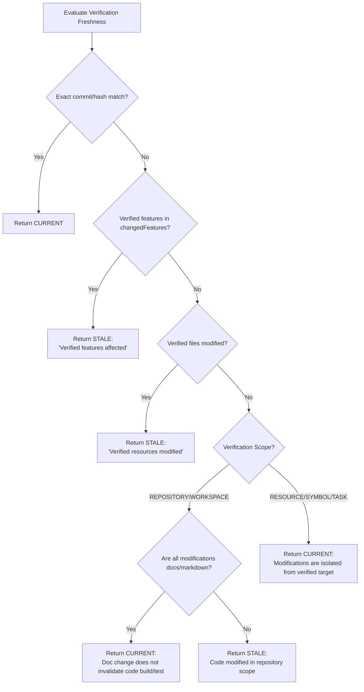

# Verification Freshness & Repository State Binding — ProjectMind Phase 7.7

A verification outcome is valid only in relation to a specific repository state. When source code evolves, previous verification evidence may become stale. Phase 7.7 introduces **Smart Freshness Evaluation** to determine whether verification evidence remains applicable without over-invalidating unrelated checks.

---

## 1. Repository State Binding

Every `VerificationRecord` is bound to a `VerificationRepositoryState`:

```typescript
export interface VerificationRepositoryState {
  readonly status: 'BOUND' | 'UNBOUND' | 'UNKNOWN';
  readonly commitId?: string | undefined;
  readonly branch?: string | undefined;
  readonly workingTreeHash?: string | undefined;
  readonly contextVersion?: number | undefined;
  readonly knowledgeVersion?: number | undefined;
  readonly changeSetId?: string | undefined;
}
```

> [!NOTE]
> ProjectMind never invents artificial commit hashes. If git metadata or working tree hashes are unavailable, `repositoryState.status` is set to `'UNKNOWN'`.

---

## 2. Freshness Statuses

| Freshness Status | Meaning | Completion Permitted? |
|---|---|---|
| `CURRENT` | Repository state is unchanged, or modifications are irrelevant to verified targets. | **Yes** |
| `STALE` | Target resources, features, or code files have changed since verification occurred. | **No** (if `disallowStale` is true) |
| `PARTIALLY_STALE` | Some verified sub-components changed, but core verification remains intact. | Policy-dependent |
| `UNKNOWN` | Repository state binding is absent or cannot be evaluated. | Policy-dependent |

---

## 3. Smart Freshness Evaluation Algorithm

Instead of naively invalidating all verifications upon any repository edit, `VerificationFreshnessEvaluator` reasons about modified files and affected features:



### Scenario Comparison:

1. **Unrelated Documentation Edit**:
   - Verification target: `src/auth/AuthService.ts`
   - Modified files: `README.md`, `docs/api.md`
   - **Result**: `CURRENT`. Unit tests for `AuthService` remain valid.

2. **Target File Edit**:
   - Verification target: `src/auth/AuthService.ts`
   - Modified files: `src/auth/AuthService.ts`
   - **Result**: `STALE`. Authentication tests must be re-executed before task completion.

3. **Feature Dependency Edit**:
   - Verification feature: `feat-authentication`
   - Modified feature: `feat-authentication`
   - **Result**: `STALE`. Feature behavior has evolved.

---

## 4. Completion Invalidation

When a task requires verification to complete:
1. `TaskCompletionValidator` queries `VerificationQueryService.getCompletionEvidence(taskId)`.
2. If previous tests are marked `STALE`, `CompletionEvidence` returns:
   - `canComplete = false`
   - `status = 'NOT_READY'`
   - `reasons = ["Verification evidence for 'TEST' is stale: Verified resources were modified: src/auth/AuthService.ts"]`
