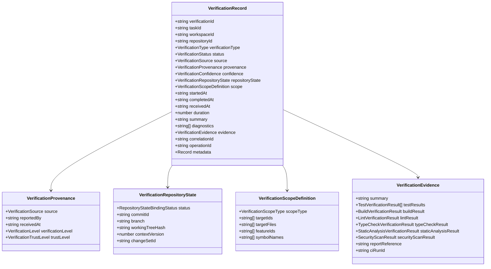

# Verification Model — ProjectMind Phase 7.7

This document details the canonical data structures and models comprising the ProjectMind Verification Integration domain (`src/verification/models/`).

---

## 1. The Canonical Verification Record

---

## 2. Verification Types (13 Types)

The verification domain supports 13 extensible types:

| VerificationType | Description |
|---|---|
| `TEST` | Execution of automated unit, integration, or regression test suites. |
| `BUILD` | Compilation, bundling, or asset synthesis verification. |
| `LINT` | Code style, syntax rules, and convention verification. |
| `TYPECHECK` | Strict static compiler type checking (e.g. `tsc --noEmit`). |
| `STATIC_ANALYSIS` | Code quality, complexity, or AST static analysis tools. |
| `SECURITY_SCAN` | SAST, dependency auditing, secret scanning, or vulnerability assessment. |
| `INTEGRATION` | Cross-system or microservice interaction verification. |
| `API_CONTRACT` | Schema validation (OpenAPI, GraphQL, Protobuf contracts). |
| `DATABASE_MIGRATION` | Verification of schema migrations and database up/down scripts. |
| `DEPLOYMENT` | Verification of deployment or container startup in target environments. |
| `RUNTIME` | Runtime health checks and synthetic monitoring. |
| `MANUAL_REVIEW` | Explicit sign-off by a designated human reviewer. |
| `UNKNOWN` | Uncategorized external verification claims. |

---

## 3. Verification Statuses (8 Statuses)

| VerificationStatus | Meaning | Terminal? | Successful? |
|---|---|---|---|
| `PASSED` | All verification checks completed successfully with zero failures. | Yes | Yes |
| `FAILED` | One or more verification checks failed. | Yes | No |
| `PARTIAL` | Some checks succeeded while non-critical checks were skipped or failed. | Yes | No |
| `SKIPPED` | Verification was skipped due to condition or environment bypass. | Yes | No |
| `BLOCKED` | Verification could not proceed due to missing dependencies or environment blockers. | No | No |
| `CANCELLED` | Verification was aborted prior to conclusion. | Yes | No |
| `RUNNING` | Verification is actively executing in the external environment. | No | No |
| `UNKNOWN` | Result is inconclusive or undetermined. | No | No |

> [!CAUTION]
> **No Inferred Success**:
> Never infer `PASSED` merely because a command completed or exited with code 0. An explicit assertion of test or build success is required.

---

## 4. Specialized Result Payloads

Under `src/verification/models/results/`, structured models encapsulate domain-specific verification evidence without storing unbounded raw console logs:

- **`TestVerificationResult`**: `testRunId`, `suite`, `testName`, `status`, `duration`, `failureSummary`, `resourceReferences`, `featureReferences`.
- **`BuildVerificationResult`**: `buildId`, `buildTarget`, `status`, `duration`, `diagnostics`.
- **`LintVerificationResult`**: `lintTool`, `status`, `errorCount`, `warningCount`, `diagnostics`.
- **`TypeCheckVerificationResult`**: `compiler`, `status`, `errorCount`, `warningCount`, `diagnostics`.
- **`StaticAnalysisVerificationResult`**: `scanner`, `status`, `findingsCount`, `findings`, `affectedResources`.
- **`SecurityScanResult`**: `scanner`, `status`, `findingsSummary`, `findings`, `scope`. Note: Does not claim "secure" merely because a scan passed; provides structured evidence to Feature Health and Risk engines.
