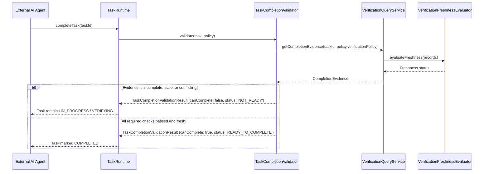

# Verification Policy & Completion Integration — ProjectMind Phase 7.7

Different tasks carry different quality, security, and verification requirements. ProjectMind avoids one-size-fits-all completion rules by introducing configurable **Verification Policies** and structured **Completion Evidence**.

---

## 1. Verification Policy Model

```typescript
export interface VerificationPolicy {
  readonly requiredTypes?: readonly VerificationType[] | undefined;
  readonly requireTrustedVerification?: boolean | undefined;
  readonly disallowStale?: boolean | undefined;
  readonly disallowConflicts?: boolean | undefined;
  readonly minimumConfidence?: VerificationConfidence | undefined;
  readonly allowedScopes?: readonly VerificationScopeType[] | undefined;
  readonly allowAgentReportedOnly?: boolean | undefined;
}
```

---

## 2. Task-Type Verification Presets

ProjectMind provides built-in presets in `TASK_TYPE_VERIFICATION_POLICIES`:

| Task Type | Required Types | Require Trusted? | Disallow Stale? | Min Confidence | Description |
|---|---|---|---|---|---|
| `BUG_FIX` | `TEST`, `BUILD` | Optional | Yes | `HIGH` | Requires passing regression tests and successful build. |
| `FEATURE` | `TEST`, `BUILD`, `TYPECHECK` | Optional | Yes | `MEDIUM` | Requires tests, build, and static compiler type checking. |
| `REFACTOR` | `TEST`, `BUILD`, `TYPECHECK`, `LINT` | Optional | Yes | `HIGH` | Strict policy requiring clean linting, type safety, and tests. |
| `SECURITY_PATCH` | `TEST`, `BUILD`, `SECURITY_SCAN` | **Yes (Authoritative)** | Yes | `CONFIRMED` | Mandatory trusted CI/security scanner confirmation. |
| `DOCS` | *(None)* | No | No | `LOW` | Lightweight verification; no test or build requirements. |

---

## 3. Completion Evidence Structure

When `TaskCompletionValidator` verifies whether a task can complete, it generates a structured `CompletionEvidence` report:

```typescript
export interface CompletionEvidence {
  readonly taskId: string;
  readonly canComplete: boolean;
  readonly status: 'READY_TO_COMPLETE' | 'NOT_READY' | 'BLOCKED' | 'INVALID';
  readonly requiredConditions: readonly RequiredVerificationCondition[];
  readonly actualEvidence: readonly ActualVerificationEvidenceItem[];
  readonly missingConditions: readonly string[];
  readonly reasons: readonly string[];
  readonly confidence: VerificationConfidence;
  readonly hasConflictingEvidence: boolean;
  readonly hasStaleEvidence: boolean;
  readonly evaluatedAt: string;
}
```

---

## 4. Completion Validation Flow



---

## 5. Explanatory Diagnostics Example

When completion is rejected, ProjectMind returns clear human- and agent-readable explanations:

```json
{
  "status": "NOT_READY",
  "canComplete": false,
  "missingConditions": [
    "Verification 'TEST' requires trusted verification",
    "Verification 'BUILD' is STALE"
  ],
  "reasons": [
    "Required test verification exists only as agent-reported evidence and no trusted verification source is available.",
    "Verification evidence for 'BUILD' is stale: Verified resources were modified: src/auth/AuthService.ts"
  ]
}
```
