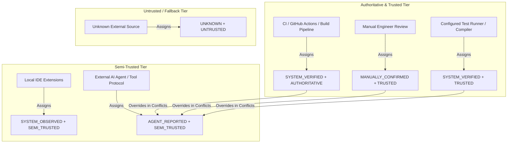
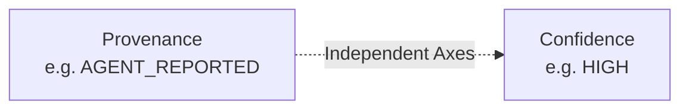

# Verification Provenance — ProjectMind Phase 7.7

Verification provenance establishes the lineage, authenticity, source tier, and trustworthiness of every verification record recorded in ProjectMind.

---

## 1. Provenance Model

```typescript
export interface VerificationProvenance {
  readonly source: VerificationSource;
  readonly reportedBy: string;
  readonly receivedAt: string;
  readonly observedAt?: string | undefined;
  readonly verificationLevel: VerificationLevel;
  readonly trustLevel: VerificationTrustLevel;
}
```

---

## 2. Verification Levels

| VerificationLevel | Description | Precedence | Can Satisfy Trusted Policy? |
|---|---|---|---|
| `SYSTEM_VERIFIED` | Independently verified by an authoritative or trusted CI/build/test runner. | 4 | **Yes** |
| `MANUALLY_CONFIRMED` | Explicitly confirmed and signed off by a human engineer/reviewer. | 4 | **Yes** |
| `SYSTEM_OBSERVED` | Passively observed via IDE or system events without full assertion guarantee. | 3 | Conditional |
| `AGENT_REPORTED` | Reported by an external autonomous or conversational AI agent. | 2 | **No** (unless policy permits) |
| `INFERRED` | Indirectly deduced by repository intelligence without explicit observation. | 1 | **No** |
| `UNKNOWN` | Source and verification origin cannot be determined. | 0 | **No** |

---

## 3. Trust Levels

| TrustLevel | Precedence | Description |
|---|---|---|
| `AUTHORITATIVE` | 4 | Dedicated CI/CD infrastructure, cryptographic or digitally signed system reports. |
| `TRUSTED` | 3 | Configured test runners, compilers, linters, and authenticated manual reviewers. |
| `SEMI_TRUSTED` | 2 | Registered developer IDEs, local agent sessions, or MCP tools. |
| `UNTRUSTED` | 1 | Unauthenticated external payloads or unknown third-party webhooks. |

---

## 4. Trust Hierarchy & Precedence



---

## 5. Confidence vs. Provenance Distinction

ProjectMind strictly distinguishes between **Confidence** (the certainty of the data measurement itself) and **Provenance** (who produced the data):



- A trusted CI pipeline executing a flaky test suite might produce:
  `SYSTEM_VERIFIED + MEDIUM`
- An external coding agent reporting comprehensive test logs might produce:
  `AGENT_REPORTED + HIGH`

Even though the agent report has `HIGH` confidence, it remains `AGENT_REPORTED` and can **never** satisfy a policy requiring independent trusted verification.

---

## 6. Anti-Forging Protection

External agents and clients cannot self-promote their reports to `SYSTEM_VERIFIED`:

```typescript
// If external payload passes:
{
  "systemVerified": true,
  "verificationLevel": "SYSTEM_VERIFIED"
}
// ProjectMind's VerificationSecurityValidator throws VerificationTrustError:
// "External agent input cannot claim verificationLevel='SYSTEM_VERIFIED'"
```

All provenance assignments are exclusively dictated by `VerificationSourceTrustRegistry` based on authenticated transport identities.
