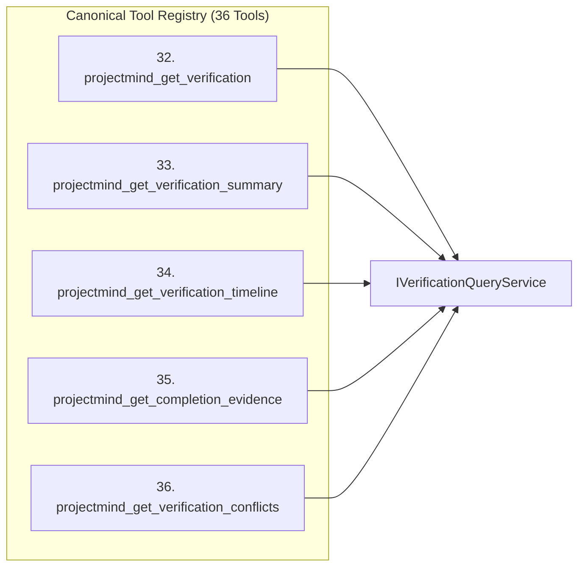

# Verification Query API & Canonical Tools — ProjectMind Phase 7.7

Phase 7.7 exposes verification evidence, summaries, timelines, and completion status through the unified `IVerificationQueryService` and 5 new read-only tools registered in the Canonical Agent Tool Protocol (expanding the registry to 36 tools).

---

## 1. IVerificationQueryService Interface

```typescript
export interface IVerificationQueryService {
  getVerification(verificationId: string): Promise<VerificationRecord | undefined>;
  getVerifications(params: VerificationQueryParams): Promise<VerificationRecord[]>;
  getTaskVerifications(taskId: string): Promise<VerificationRecord[]>;
  getFeatureVerifications(featureId: string): Promise<VerificationRecord[]>;
  getResourceVerifications(resourcePath: string): Promise<VerificationRecord[]>;
  getVerificationSummary(taskId: string, workspaceId?: string, repositoryId?: string): Promise<VerificationSummary>;
  getVerificationTimeline(taskId: string): Promise<VerificationTimeline>;
  getVerificationConflicts(taskId?: string): Promise<VerificationConflict[]>;
  getLatestVerification(taskId: string, type?: VerificationType): Promise<LatestVerificationResult>;
  getFreshness(verificationId: string, currentParams?: FreshnessEvaluationParams): Promise<VerificationFreshness>;
  getCompletionEvidence(taskId: string, policy?: VerificationPolicy, currentParams?: FreshnessEvaluationParams): Promise<CompletionEvidence>;
}
```

---

## 2. Canonical Tool Registry Integration (Tools 32 to 36)



### 32. `projectmind_get_verification`
- **Purpose**: Retrieve specific verification records or filter verification evidence by task, feature, or resource path.
- **Safety Level**: `READ_ONLY`
- **Capabilities Required**: `['VERIFICATION_READ']`
- **Arguments**:
  - `verificationId?: string`
  - `taskId?: string`
  - `verificationType?: string`
  - `resourcePath?: string`
  - `featureId?: string`
  - `limit?: number` (default: 50, max: 200)

### 33. `projectmind_get_verification_summary`
- **Purpose**: Retrieve aggregated verification summary metrics (`total`, `passed`, `failed`, `latestStatus`, `trustedStatus`, `agentReportedStatus`, `byType`, `conflicts`) for a task.
- **Safety Level**: `READ_ONLY`
- **Capabilities Required**: `['VERIFICATION_READ']`
- **Arguments**:
  - `taskId: string` (required)

### 34. `projectmind_get_verification_timeline`
- **Purpose**: Retrieve chronological read-oriented verification timeline events and repository state bindings for a task.
- **Safety Level**: `READ_ONLY`
- **Capabilities Required**: `['VERIFICATION_READ']`
- **Arguments**:
  - `taskId: string` (required)

### 35. `projectmind_get_completion_evidence`
- **Purpose**: Retrieve structured task completion evidence, verifying required evidence types, freshness, trusted provenance, and absence of unresolved conflicts.
- **Safety Level**: `READ_ONLY`
- **Capabilities Required**: `['VERIFICATION_READ']`
- **Arguments**:
  - `taskId: string` (required)
  - `requireTrusted?: boolean`

### 36. `projectmind_get_verification_conflicts`
- **Purpose**: Retrieve verification conflicts detected between agent reports and trusted/system verification results for a task.
- **Safety Level**: `READ_ONLY`
- **Capabilities Required**: `['VERIFICATION_READ']`
- **Arguments**:
  - `taskId?: string`

---

## 3. Reporting Verification (`projectmind_report_verification`)

Agents report local verification results via the canonical `projectmind_report_verification` tool:

```json
{
  "toolName": "projectmind_report_verification",
  "arguments": {
    "taskId": "task-login-fix",
    "passed": true,
    "summary": "Integration tests for authentication passed locally",
    "testResults": [
      { "testName": "testTokenRefresh", "status": "PASSED", "duration": 34 }
    ],
    "operationId": "op-verif-402"
  }
}
```

The tool handler routes the payload through `VerificationProcessor`:
1. It assigns provenance: `verificationLevel: 'AGENT_REPORTED'`, `trustLevel: 'SEMI_TRUSTED'`.
2. Normalizes resource references and timestamps.
3. Emits `ExecutionObservation` reference to maintain unified timeline consistency.
4. Stores canonical verification evidence in `InMemoryVerificationStore`.
