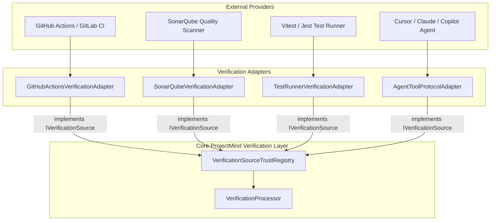

# Verification Sources & Adapters — ProjectMind Phase 7.7

ProjectMind ingests verification data from diverse external systems, ranging from local CLI coding agents to enterprise CI/CD runners. Phase 7.7 establishes a pluggable, adapter-based source architecture (`IVerificationSource`).

---

## 1. The Verification Source Interface

```typescript
export interface SourceCapabilities {
  readonly supportedTypes: readonly string[];
  readonly supportsStreaming?: boolean | undefined;
  readonly canProvideRepositoryState?: boolean | undefined;
}

export interface IVerificationSource {
  getSourceId(): string;
  getSourceType(): VerificationSource;
  getTrustLevel(): VerificationTrustLevel;
  getVerificationLevel(): VerificationLevel;
  getCapabilities(): SourceCapabilities;
}
```

---

## 2. Canonical Verification Sources

| Source | Default Trust Level | Default Verification Level | Allowed To Independently Verify? |
|---|---|---|---|
| `CI` | `AUTHORITATIVE` | `SYSTEM_VERIFIED` | **Yes** |
| `BUILD_SYSTEM` | `TRUSTED` | `SYSTEM_VERIFIED` | **Yes** |
| `TEST_RUNNER` | `TRUSTED` | `SYSTEM_VERIFIED` | **Yes** |
| `SYSTEM` | `AUTHORITATIVE` | `SYSTEM_VERIFIED` | **Yes** |
| `MANUAL` | `TRUSTED` | `MANUALLY_CONFIRMED` | **Yes** |
| `IDE` | `SEMI_TRUSTED` | `SYSTEM_OBSERVED` | No |
| `AGENT` | `SEMI_TRUSTED` | `AGENT_REPORTED` | No |
| `MCP` | `SEMI_TRUSTED` | `AGENT_REPORTED` | No |
| `UNKNOWN` | `UNTRUSTED` | `UNKNOWN` | No |

---

## 3. Adapting Future Trusted Systems



### Implementing a Custom Trusted Adapter Example:

```typescript
import type { IVerificationSource, SourceCapabilities } from '../../src/verification/interfaces/IVerificationSource.js';

export class GitHubActionsVerificationAdapter implements IVerificationSource {
  public getSourceId(): string {
    return 'github-actions-ci';
  }

  public getSourceType(): VerificationSource {
    return 'CI';
  }

  public getTrustLevel(): VerificationTrustLevel {
    return 'AUTHORITATIVE';
  }

  public getVerificationLevel(): VerificationLevel {
    return 'SYSTEM_VERIFIED';
  }

  public getCapabilities(): SourceCapabilities {
    return {
      supportedTypes: ['TEST', 'BUILD', 'LINT', 'SECURITY_SCAN'],
      canProvideRepositoryState: true,
    };
  }
}
```
Registering this adapter into `VerificationSourceTrustRegistry` immediately enables incoming GitHub Actions webhook events to qualify as `SYSTEM_VERIFIED` without any modification to ProjectMind's core verification or task completion engines.
